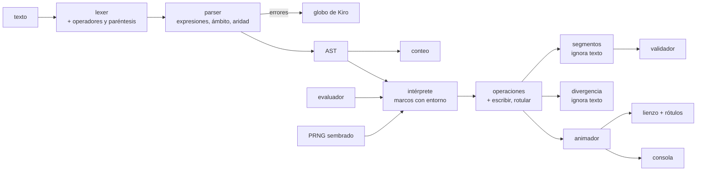

# Design Document

**KiroLogo · Spec 05 · Mundo 4 · Parámetros**

## Overview

Esta spec agrega el mundo 4 completo (cuatro niveles) y las capacidades del lenguaje que lo hacen
posible: **parámetros** en `PARA`, **aritmética** infija con precedencia y paréntesis, los comandos
`SUMA`, `RESTA`, `PRODUCTO`, `COCIENTE` y `RESTO`, **`AZAR`** determinista, **`ESCRIBE`** con una
consola y **`ROTULA`** sobre el lienzo. Cierra con la insignia *Generalización*.

A diferencia de la spec 04, aquí **casi todo es nuevo**: el lexer no conoce operadores, el parser no
conoce parámetros, el intérprete solo evalúa literales y el impresor solo sabe escribir comandos
simples. El diseño parte del código real de `origin/spec-04-mundo-3` (la rama activa solo tiene el
mundo 0; ver R27.1), leído con `git show`, y corrige donde los requisitos y ese código no coinciden.
No se modificó ningún archivo fuera de esta carpeta.

Las 10 decisiones propuestas del documento de requisitos se adoptan **sin cambios**. Ninguna resultó
inviable. Donde el código obliga a precisar o a matizar un criterio, la resolución está en la sección
siguiente y se marca como *a confirmar* si altera la letra del requisito.

### Estado verificado del código

| Pieza | Estado en `spec-04-mundo-3` | Qué falta |
|---|---|---|
| `ast.ts`: `DefinicionProcedimiento.parametros`, `ReferenciaParametro`, `InvocacionProcedimiento`, `ExpresionAritmetica` | Declarados. `Expresion` solo une número, parámetro y aritmética | Nodos `PalabraLiteral`, `MenosUnario`, `ComandoOperador` |
| `lexer.ts` | `[`, `]`, `"palabra`, `:param`, números. Todo símbolo aritmético es `caracterNoValido` | Tokens `operador`, `parentesis_abre`, `parentesis_cierra` |
| `parser.ts` | Dos pasadas, pero la primera solo guarda **nombres** (`Set<string>`). `REPITE` y comandos exigen un token `numero`. Ignora los `:param` de la cabecera desde el mundo 4 | Firmas con parámetros, expresiones, ámbito, aridad |
| `interprete.ts` | Pila de marcos sin entorno. `argumento()` solo lee `numeroLiteral`. El PRNG "queda listo" pero no se crea | Evaluador, marcos con entorno, `AZAR`, operaciones de texto |
| `conteo.ts` | No recorre expresiones (cuentan 0 por omisión, sin detectar nodos desconocidos) | Recorrido exhaustivo de expresiones |
| `impresor.ts` | **Solo imprime `invocacionComando`.** `REPITE`, `PARA` e invocaciones son `nodoNoImprimible` | Reescritura casi completa (R14) |
| `vocabulario.ts` | Entradas del mundo 4 como marcadores; sin campos `produceValor` ni `ejecutable` | Campos nuevos, tipo `valorEscribible`, firmas corregidas |
| `errores.ts` | 47 ids. `limiteDuroExcedido` ya trae la sugerencia del mundo 4 | 17 ids nuevos y la ampliación de `argumentoDeTipoEquivocado` |
| `abstraccion.ts` | `usaParametros` no exige invocar el `PARA`; recorrido de expresiones sin `default` | Endurecer `usaParametros`, nodos nuevos |
| `estrellas.ts` | `mensajeAbstraccion` solo cubre `usaRepite` | Textos de R22, precisión como requisito |
| `reto.ts` | `presupuestoEstrella`, `limiteDuro` y `limiteDuroActivo` derivados; `margenLimiteDuro` por nivel | Nada |
| `main.ts` (`ejecutarPrograma`) | Ya pasa `semilla: reto.semillaEfectiva` al intérprete (R8.4 **ya se cumple**) y guarda el límite duro con `mundo` | Consola, anuncios, `lineaLlamada` |
| `niveles/generadores/`: contrato `Generador`, `generarConReintento`, registro | Hechos | Tres generadores, ampliar `cajaDeReferencia` |
| `desafio-infinito.ts`, `insignias.ts`, `desbloqueo.ts`, `mundos.ts` | Genéricos por mundo; `MUNDOS[4]` ya dice «Parámetros» / «Generalización» | Una insignia, una regla de desafío, un comentario |
| `menu-mundos.ts` | Muestra la medalla con `insigniasDelMundo(mundo)` | Nada: aparece sola al agregar la insignia |

### Discrepancias entre los requisitos y el código real

Todas se resuelven sin cambiar una decisión cerrada. Las marcadas **(a confirmar)** alteran la letra
de un criterio y conviene que el usuario las apruebe antes de pasar a tareas.

| # | Hallazgo | Requisitos | Resolución |
|---|---|---|---|
| D1 | El impresor no imprime `REPITE`, `PARA` ni llamadas, y su prueba vigente exige que un `repeticion` sea `nodoNoImprimible`. `pistas.ts` lo usa solo con comandos simples | R14, R23.4 | Se reescribe. La prueba cambia su ejemplo de nodo reservado a `condicionalUnaRama`. Se agrega `opciones.hueco` para los esqueletos |
| D2 | `rellenarPistas` solo conoce `{tramos}`, `{giro}`, `{cuadros}`, `{esqueleto}`, calculados mirando los `AVANZA`/giros **del nivel superior**. En el mundo 4 estarían dentro de un `PARA` | R23 | Placeholders nuevos leídos de las llamadas del nivel superior y `{esqueletoConHuecos}` (el `{esqueleto}` del mundo 0 no cambia) |
| D3 | `cajaDeReferencia` (en `generadores/comun.ts`) solo entiende `repeticion` con literal y comandos con literal. Ante un `PARA` devuelve `null` y **descarta todos los candidatos**: los tres generadores agotarían los 200 intentos | R20.6, R20.7 | Se amplía con el evaluador de `lenguaje/` (puro, sin dependencias) y un mapa de definiciones |
| D4 | `REPITE n` apila **n marcos** de golpe, y `profundidad = pila.length − 1`. Un `REPITE 120 [CUADRADO]` dispara `guardaRecursion` sin recursión, y con cantidades calculadas el problema crece | R4.6, R7, R25.6 | Marcos con contador de iteraciones. `profundidad` pasa a contar solo marcos de procedimiento, como ya documenta `OperacionBase` («0 a 100, 0 en el cuerpo principal») |
| D5 | `main.ts` no pasa `ahora` a `ejecutar`, así que la guarda de 5 s **nunca dispara** en producción. Un `REPITE` con cuerpo vacío tampoco suma pasos. Con la cantidad ahora calculable (`REPITE 99999 * 99999 []`) eso cuelga la pestaña | Steering `tecnologia` | `maximoCiclos` determinista en los límites, y `main.ts` inyecta `ahora` |
| D6 | `divergencia.ts` compara **todos** los tipos de operación, cuenta desde 0 y ejecuta con `semilla: 0`. R25.7 pide ignorar texto, contar desde 1 y R8.6 pide la misma semilla | R8.6, R9.12, R25.7 | Filtro `operacionesComparables`; campo `orden` (1-based) junto a `indice`; parámetro `semilla`. **(a confirmar)**: se filtran solo `escribir` y `rotular`, no se ignoran `lapiz`, `color`, etc. «Únicamente movimiento y giro» cambiaría el comportamiento ya probado del mundo 2 |
| D7 | `calificar` otorga abstracción sin mirar la precisión cuando el nivel declara exigencias (R21.6 lo prohíbe). `mensajeAbstraccion` se calcula pero **ningún módulo lo muestra**, y el globo recorta el resultado a 300 caracteres | R21.6, R22 | `calificar` exige precisión. El globo muestra la explicación en líneas propias sin recorte. **(a confirmar)**: mostrarla también vuelve visible la invitación `usaRepite` de los mundos 1 y 2, que hoy es código muerto |
| D8 | `vocabulario.ts` no tiene `ejecutable` (R12.4) y `PLANTILLAS_ARGUMENTO` es un `Record<TipoArgumento, …>` | R6.1, R12 | Se agregan `produceValor` y `ejecutable` obligatorios y el tipo `valorEscribible`; el compilador obliga a su plantilla |
| D9 | R6.4 pide `argumentoDeTipoEquivocado` para `AVANZA AVANZA 10`, pero una prueba vigente exige `argumentoFaltante` para `AVANZA GIRADERECHA 90` (misma forma) | R6.4 | **(a confirmar)** Regla de línea: acción **en la misma línea** → tipo equivocado; en una línea posterior → `argumentoFaltante`. Se actualiza esa prueba; el olvido típico en programas de varias líneas mantiene su mensaje |
| D10 | El lexer entrega `valor` de `:Largo` en MAYÚSCULAS (`normalizarPalabra`); R1.2 y R16.2 piden minúsculas (`largo`) | R1.2 | El parser baja a minúsculas los nombres de parámetro. Los nombres de procedimiento siguen en mayúsculas |
| D11 | `desafioDisponible` exige precisión en todos los niveles; R24.5 liga el desafío del mundo 4 a la insignia (tres estrellas) | R24.5 | **(a confirmar)** Tabla `UMBRAL_DESAFIO_POR_MUNDO` (datos): 0 a 3 `precision` (sin cambios), 4 `tresEstrellas`. Poner `precision` en el 4 deja todos los mundos iguales y relaja R24.5 |
| D12 | `semillaNuevaParaNivel` deriva la semilla del reloj de animación: viola R8.9 y no garantiza una semilla distinta (R25.2) | R8.9, R25.2 | `azar/entropia.ts` con `crypto.getRandomValues`, inyectable, con reintento si coincide |
| D13 | `role="log"` implica `aria-live="polite"`. R10.1 prohíbe el atributo, pero sin él el lector leería cada línea de un `REPITE 100 [ES 1]`, que es lo que la decisión 5 evita | R10.1, decisión 5 | **(a confirmar)** `aria-live="off"` explícito en el registro. Se valida con lector de pantalla en la prueba manual |
| D14 | R12.8: «exactamente los procedimientos **con al menos un parámetro**»; hoy el panel lista todos los procedimientos válidos | R12.8 | El panel sigue listando todos; los que tienen parámetros muestran la cabecera (`POLIGONO :lados :largo`). Quitar los sin parámetros sería una regresión de la spec 03 |
| D15 | El título «concéntricos» del 4.3 no describe la figura: las llamadas parten del mismo punto y rumbo y no hay movimiento entre ellas, así que los polígonos **comparten un vértice y el primer lado** | R18 | Ver «Nivel 4.3». Se renombra «Polígonos encajados» y se corrigen el steering y el enunciado. Los requisitos 18.2 a 18.9 no cambian |
| D16 | `Nivel` no tiene campo `enunciado` (R16.3, R17.9, R18.9, R19.7 lo mencionan). El mundo 3 puso «la posición y el rumbo importan» dentro de la pista conceptual | R16.3 y afines | Campo opcional `enunciado` en `Nivel`, que el globo usa como saludo. Los niveles 0 a 3 no lo declaran |
| D17 | R25.9 y R11.9 piden anunciar cada operación/rótulo al aplicarla. La spec 00 (28.9) decidió que una ejecución continua anuncia **solo su final** | R11.9, R25.9 | Paso a paso: un anuncio por operación (ya ocurre, también dentro de procedimientos). Ejecución continua: un único anuncio final que incluye las líneas de consola y los rótulos. **(a confirmar)** |
| D18 | `lenguaje/interprete.ts` importa `../motor/tortuga.js`, contra «`lenguaje/` no importa nada». No lo introduce esta spec | estructura.md | No se corrige aquí. Los módulos nuevos de `lenguaje/` (`evaluador.ts`) no importan nada, y `niveles/` solo usa ese |
| D19 | R21.1(c) dice «invocado en cualquier parte»; una llamada del `PARA` a sí mismo no lo hace alcanzable | R21.1 | Cuenta solo una invocación **fuera del cuerpo de ese `PARA`**. Refinamiento sin efecto en el mundo 4 (no hay condicional para recursión) |
| D20 | 3 es un número de lados casi imposible en el 4.3: con lado ≤ 200 un triángulo mide 200 × 173, y R20.6 exige ≥ 200 en ambos ejes | R18.3, R20.6 | Se mantiene el rango 3 a 8. El descarte y reintento (R20.7) lo filtra. Con 4 lados solo pasa el lado 200 |
| D21 | `ContextoDibujo` y `EstiloLienzo` no incluyen texto ni tipografía de rótulo | R11.5 | Se amplía el `Pick` con `fillText`, `font`, `textAlign` y `textBaseline` y `EstiloLienzo.rotulo`. Los dobles de dibujo de las pruebas ganan esos miembros |

Otras comprobaciones que **no** son discrepancias: el contador del editor ya marca el bloqueo por límite
duro con texto (R25.11); `resolverPalabraNoEjecutable` ya aplica los umbrales de R6.6 sobre todo el
vocabulario desbloqueado; `desbloqueo.ts` abre el mundo 4 con precisión en el 3 (R24.4) sin cambios;
la semilla de 7 caracteres y su decodificación ya cumplen R25.3 a R25.5.

Qué se construye, entonces:

1. Lenguaje: nodos, tokens, parser con expresiones/ámbito/aridad, evaluador, marcos con entorno,
   `AZAR`, `ESCRIBE`, `ROTULA`, conteo, impresor y 17 errores nuevos (R1 a R15).
2. Motor: operaciones `escribir` y `rotular` y su efecto en segmentos, divergencia, animador y lienzo
   (R9 a R11, R25).
3. Juego: abstracción, explicación de Kiro, pistas, insignia y desafío (R21 a R24).
4. Niveles: 4.1 a 4.4, tres generadores y la ampliación de la caja de referencia (R16 a R20).
5. Interfaz: consola, rótulos, resaltado de llamada, panel de procedimientos y semilla (R10, R12, R25).
6. Documentación: steering y bitácora (R26).

## Architecture

### Flujo completo



El flujo del intento (análisis → guarda de límite duro → ejecución → animación → `concluirIntento`)
**no cambia de forma**: lo que cambia es lo que cada etapa entiende. La ejecución sigue siendo un solo
generador que alimenta a todos los consumidores (steering `tecnologia`).

### Lenguaje

#### AST (`ast.ts`)

```typescript
/** `"hola` en ESCRIBE y ROTULA. `valor` es el texto tal como se escribió, sin la comilla. */
export interface PalabraLiteral extends NodoBase { readonly tipo: 'palabraLiteral'; readonly valor: string }
/** `-:largo`, `-(1 + 2)`. */
export interface MenosUnario extends NodoBase { readonly tipo: 'menosUnario'; readonly operando: Expresion }
/** SUMA, RESTA, PRODUCTO, COCIENTE, RESTO, AZAR: los de `produceValor` en el vocabulario. */
export interface ComandoOperador extends NodoBase {
  readonly tipo: 'comandoOperador';
  readonly nombre: string;                       // nombre largo del vocabulario
  readonly argumentos: readonly Expresion[];     // 2 (los cinco aritméticos) o 1 (AZAR)
}
export type Expresion =
  | NumeroLiteral | PalabraLiteral | ReferenciaParametro
  | ExpresionAritmetica | MenosUnario | ComandoOperador;
```

Decisiones:

- `ComandoOperador.nombre` es `string` y no una unión literal: así ninguna lista de nombres vive fuera de
  `vocabulario.ts` (R6.2). La semántica de cada uno vive en `evaluador.ts`, en una tabla cuyas claves una
  prueba compara con las entradas de `produceValor` (ver Testing).
- `ExpresionAritmetica.operador` conserva `=`, `<`, `>` (mundo 5). El parser nunca los produce; el
  evaluador y el impresor los rechazan (`nodoNoImplementado`, `nodoNoImprimible`).
- `PalabraLiteral` es una `Expresion` para que `InvocacionComando.argumentos` siga siendo `Expresion[]`
  y para que todo recorrido deba decidir qué hace con ella (R21.5).
- `MenosUnario` es un nodo propio y no `0 - x`: el impresor y la ida y vuelta (R14) necesitan
  distinguirlos, y `-:largo` no es lo mismo que `0 - :largo` al imprimir.
- Los números del lexer son siempre no negativos. Un `numeroLiteral` negativo o no finito no es
  imprimible (`nodoNoImprimible`): el menos es siempre un `MenosUnario`.

#### Lexer (`lexer.ts`)

`TipoToken` gana `'operador' | 'parentesis_abre' | 'parentesis_cierra'`. `operador` lleva `valor` en
`'+' | '-' | '*' | '/'`. Se emiten **siempre**, sin mirar el mundo (R3.1): decidir si están permitidos es
trabajo del parser. `=`, `<` y `>` siguen cayendo en `caracterNoValido` (R3.13).

```typescript
// En el bucle principal, antes del caso «cualquier otro carácter»:
if (c === '+' || c === '-' || c === '*' || c === '/') {
  tokens.push({ tipo: 'operador', valor: c, textoOriginal: c, linea: cursor.linea, columna: cursor.columna });
  avanzar(cursor); continue;
}
if (c === '(' || c === ')') { /* parentesis_abre | parentesis_cierra */ }
```

No hay lexado especial de signos en los números: `-5` son dos tokens. Así `100-50`, `100 - 50` y `100 -50`
producen los mismos tokens y la decisión «unario o binario» es del parser, que ve el contexto.

`100*2` ya produce tres tokens porque `leerNumero` consume solo dígitos y separadores decimales.
Cuidado conocido: `10,5` es un decimal; `SUMA 1,2` es el número `1,2`, no dos argumentos. Es la regla
vigente («coma o punto») y se documenta en el steering.

#### Parser (`parser.ts`)

**Primera pasada con firmas.** `recolectarProcedimientos` pasa de `Set<string>` a
`Map<string, Firma>`, que conserva el orden de inserción:

```typescript
export interface FirmaProcedimiento {
  readonly nombre: string;                        // normalizado, MAYÚSCULAS
  readonly parametros: readonly string[];         // minúsculas, sin ':', sin duplicados
  readonly escritos: readonly string[];           // tal como los escribió el jugador, con ':'
  readonly linea: number;
  readonly rechazada: boolean;                    // parametroDuplicado: sin nodo, pero conocida
}
export function firmasDeProcedimientos(tokens: readonly Token[], mundo: Mundo): readonly FirmaProcedimiento[];
export function nombresDeProcedimientos(tokens: readonly Token[], mundo: Mundo): readonly string[]; // derivada
```

- Los parámetros son los tokens `parametro` **consecutivos** tras el nombre. Se bajan a minúsculas
  (D10).
- Una firma con parámetro repetido se registra con la lista sin duplicados y `rechazada: true`: así
  las llamadas posteriores se validan contra una aridad razonable y no encadenan «No sé cómo hacer…».
  La segunda pasada reporta `parametroDuplicado` y no emite el nodo; el panel no la lista (R1.5).
- Misma regla de aceptación que hoy para los tres rechazos existentes (pisa el lenguaje, redefinición,
  `PARA` sin `FIN`) (R1.7, R1.8).
- En mundos menores que 4 un parámetro en la cabecera sigue reportando `paraConParametros` y el
  procedimiento no se define (R1.4).

**Estado nuevo.**

```typescript
interface Estado {
  /* …los campos actuales… */
  readonly firmas: Map<string, FirmaProcedimiento>;
  ambito: ReadonlySet<string> | null;      // parámetros del PARA que se está analizando; null en el programa principal
  profundidadParentesis: number;           // límite 32
  alturaExpresion: number;                 // límite 128, defensa de pila
  aritmeticaBloqueadaReportada: boolean;
}
const MAXIMO_PARENTESIS = 32;              // R3.11
const MAXIMA_ALTURA_EXPRESION = 128;       // ver «Cadenas largas»
```

**Gramática.** Descenso recursivo, una función por nivel:

```
expresion = termino { ("+" | "-") termino } ;           asociatividad izquierda
termino   = unario  { ("*" | "/") unario  } ;
unario    = "-" unario | primario ;
primario  = NUMERO | PARAMETRO | "(" expresion ")" | operador ;
operador  = NOMBRE_OPERADOR expresion { expresion } ;  aridad exacta, leída del vocabulario
```

- El menos unario liga más que `*`: `-2 * 3` es `(-2) * 3` (R3.2). Está en `unario`, por lo que
  `AVANZA 100 * -1`, `1 - -2` y `AVANZA (-:largo)` son válidos (R3.4).
- Cada argumento es la `expresion` más larga posible: `SUMA 1 2 * 3` es `SUMA 1 (2 * 3)` (R3.6).
  La aridad exacta evita ambigüedad: tras el último argumento el comando termina.
- `analizarExpresion` devuelve `Expresion | null`. Al fallar ya reportó el error y el llamador
  sincroniza.

**Regla de la línea.** El lenguaje no es orientado a líneas, pero R3.10 y R7.5/7.6 hablan de «fin de
línea». Se formaliza así, sin romper `AVANZA⏎100`, que hoy es válido:

1. Un operador infijo continúa la expresión solo si está en la **misma línea** que el último token del
   operando izquierdo; su operando derecho debe estar en la misma línea que el operador (si no,
   `expresionIncompleta`, R3.10).
2. El **primer** argumento de cualquier instrucción puede empezar en una línea posterior (comportamiento
   actual). Los argumentos **segundo y siguientes** de una llamada o de un comando operador deben
   empezar en la línea donde terminó el argumento anterior; si no, faltan (R7.5).
3. El token que sobra (R7.6) se busca en la misma línea que el último argumento.

Consecuencia documentada: `POLIGONO 6 -80` se lee `POLIGONO (6 - 80)` y falta un argumento. El error
`procedimientoArgumentosFaltantes` agrega una frase cuando el último token consumido fue un `-`
binario: «¿Querías escribir (-80) con paréntesis?». Es una ampliación del texto del catálogo; las formas
de la tabla de R15.4 no cambian porque la frase solo aparece en ese caso (parámetro opcional
`menosComoResta`).

**Ámbito (R2).** Al entrar a un `PARA` válido, `estado.ambito = new Set(firma.parametros)`; se restaura
`null` al salir. Cada `token.tipo === 'parametro'` en posición de operando se resuelve contra
`estado.ambito`; si no está (o el ámbito es `null`) se reporta `variableNoDefinida` con la posición del
token y **se devuelve igual un `ReferenciaParametro`**, para seguir y encontrar todos los demás. El
programa resultante no se ejecuta porque hay errores (R2.8). Ninguna regla dinámica: un procedimiento
llamado desde otro no hereda nada, porque el cuerpo solo se analiza contra su propia firma.

**Argumentos de llamada (R7).** Para `identificador` presente en `firmas`:

```typescript
function analizarInvocacion(estado: Estado, token: Token, firma: FirmaProcedimiento): Instruccion | null
```

1. Para cada parámetro, en orden: si el token siguiente no puede empezar una expresión o viola la regla
   de la línea → `procedimientoArgumentosFaltantes` con los nombres que faltan **como se declararon**
   (`escritos`, R15.5). Un `palabra` → `argumentoDeTipoEquivocado` con `parametro` (R7.8).
2. Tras el último argumento, si el siguiente token de la misma línea es `numero`, `parametro` o
   `parentesis_abre` → `procedimientoArgumentosDeMas` (R7.6). Si la firma tiene 0 parámetros, el mismo
   error con `esperados: []` (R7.7).
3. Un `identificador` en posición de expresión: si es un procedimiento →
   `argumentoDeTipoEquivocado` (R6.5); si no, `resolverPalabraNoEjecutable` (como hoy).

**Comandos de operador y de acción (R6).**

- Un `comando` con `produceValor` verdadero en posición de instrucción →
  `operadorSinUso` con ejemplo `ESCRIBE <operador con sus argumentos>` construido del vocabulario.
  El parser consume sus argumentos para dar un ejemplo real (`ESCRIBE SUMA 1 2`), pero no los incluye en
  el AST.
- Un `comando` de acción en posición de expresión: misma línea → `argumentoDeTipoEquivocado`
  (R6.4, D9); línea posterior → `argumentoFaltante`.

**Despacho de argumentos por tipo del vocabulario** (reemplaza `aridad === 1` y `includes('lista')`):

| `tiposArgumento[0]` | Ruta |
|---|---|
| `numero` con aridad 1 (`AVANZA`, `RETROCEDE`, `GD`, `GI`, `PONGROSOR`) | `analizarExpresion` |
| `numero` con `lista` (`REPITE`) | `analizarExpresion` y luego `[` … `]` |
| `valorEscribible` (`ESCRIBE`, `ROTULA`) | token `palabra` → `PalabraLiteral`; si no, `analizarExpresion` |
| `color` (`PONCOLOR`, `RELLENA`) | `analizarComandoColor`, sin cambios (R3.14) |

**Mundo menor que 4.** Antes de analizar, una pasada barata sobre los tokens: si hay un token
`operador`, `parentesis_abre` o `parentesis_cierra`, se reporta **un** `aritmeticaBloqueada` con el
primero en orden de lectura (símbolo, línea y mundo 4) y se sigue analizando el resto sin volver a
reportarlo (R3.12). Los comandos de operador antes del mundo 4 ya producen `comandoBloqueado` por cada
ocurrencia (R5.6).

**Paréntesis.** `parentesisSinCerrar` lleva la línea del `(` abierto; `parentesisDeMas` la del `)`
huérfano. Un `)` fuera de una expresión llega a `analizarInstruccion` y se reporta con el mismo
mensaje. Los niveles de paréntesis se cuentan en `estado.profundidadParentesis`; el 33 reporta
`expresionDemasiadoProfunda` y corta sin lanzar excepción (R3.11).

**Cadenas largas.** `1+1+1+…` con 5 000 términos (cabe en los 10 000 caracteres del editor) produciría
un árbol de altura 5 000, y `evaluar`, `contarInstrucciones`, `imprimir` y `analizar` (abstracción) son
recursivos. `analizarExpresion` mide la altura del nodo que construye y, pasadas 128, reporta
`expresionDemasiadoProfunda`. Es defensa de pila, no regla de producto: el texto del mensaje habla de
paréntesis, que es lo más cercano del catálogo cerrado de R15.

**Sincronización.** `sincronizar` y `sincronizarEnLista` hoy se detienen en cualquier token `comando`.
Con operadores, un error dentro de `ESCRIBE SUMA 1 +` se detendría en `SUMA` y daría un error en
cascada. Se detienen **solo en comandos de acción** (`!produceValor`).

**`PARA` con parámetros.** `analizarDefinicion` consume los `parametro` consecutivos de la cabecera y,
si `mundo >= 4`, los guarda en el nodo (`parametros: firma.parametros`). Se elimina el comentario y la
lógica que ignoraban los parámetros.

#### Evaluador (`evaluador.ts`, nuevo)

Módulo puro de `lenguaje/` que **no importa nada** salvo `errores.ts` y los tipos de `ast.ts`. Lo usan el
intérprete y, para medir cajas, `niveles/generadores/comun.ts` (D3).

```typescript
export interface ContextoEvaluacion {
  readonly valores: ReadonlyMap<string, number>;   // parámetros del marco en curso
  readonly linea: number;                          // línea de la instrucción, para los errores
  readonly azar: (n: number) => number;            // entero en [0, n − 1]
}
export type ResultadoEvaluacion =
  | { readonly exito: true; readonly valor: number }
  | { readonly exito: false; readonly error: ErrorKiroLogo };

export function evaluar(expresion: Expresion, contexto: ContextoEvaluacion): ResultadoEvaluacion;
export function formatearNumero(valor: number): string;               // Texto_Numerico
export function cantidadDeRepeticiones(valor: number): number | null; // R4.6 y R4.7
```

Reglas, todas de R4:

- Escrito a mano, doble precisión, **sin redondeo intermedio**. Sin `eval` ni `new Function`.
- Izquierda a derecha: si ambos operandos fallan, gana el de la izquierda (R4.2).
- `/`, `COCIENTE` y `RESTO` con divisor `=== 0` (también `-0`) → `divisionPorCero`. Si el resultado no
  es finito sin divisor cero → `numeroFueraDeRango`. Con operandos ya finitos solo puede salir de un
  desbordamiento.
- `RESTO` usa `%` de JavaScript: signo del dividendo (`RESTO -7 3` es −1).
- `AZAR n`: `Number.isInteger(n) && n >= 1`, si no `azarRangoInvalido` con el valor. Delega en
  `contexto.azar(n)`. El evaluador **no conoce el PRNG**: lo inyecta el intérprete (R8.3).
- `PalabraLiteral` en contexto numérico y los operadores `= < >`: `nodoNoImplementado`. El parser los
  impide; es defensa.
- Una referencia sin valor en el marco (no ocurre tras un parse correcto) devuelve `variableNoDefinida`.
- `cantidadDeRepeticiones(v)`: `r = Math.round(v)`; devuelve `r` si `|v − r| < 1e-9 && r >= 0`, si no `null`.
  Solo `REPITE` usa la tolerancia; giros y avances usan el valor exacto (R4.11).

`formatearNumero`: `toFixed(4)`, quita ceros finales y el punto sobrante, y devuelve `0` para `-0` y
para `-0.0000`. A partir de 1e21 `toFixed` devuelve notación exponencial y se deja así. Cubre R9.2 y
R9.6 y el texto de los rótulos.

La tabla de semántica de los operadores vive en este módulo:

```typescript
const OPERADORES: Readonly<Record<string, (a: number, b: number) => number>> = {
  SUMA: (a, b) => a + b, RESTA: (a, b) => a - b, PRODUCTO: (a, b) => a * b,
  COCIENTE: (a, b) => a / b, RESTO: (a, b) => a % b,
};
```

`AZAR` se trata aparte (un argumento, efecto). Una prueba exige que las claves de `OPERADORES` más
`AZAR` sean exactamente las entradas con `produceValor`.

#### Intérprete (`interprete.ts`)

**Operaciones nuevas.**

```typescript
export interface OperacionEscribir extends OperacionBase {
  readonly tipo: 'escribir';
  readonly texto: string;                      // Texto_Numerico, o la palabra sin comilla
}
export interface OperacionRotular extends OperacionBase {
  readonly tipo: 'rotular';
  readonly texto: string;
  readonly posicion: Punto;                    // posición de la tortuga; la tortuga no se mueve
  readonly color: Color | null;                // el de PONCOLOR; null = el del tema
}
// OperacionBase gana, opcional para no romper los datos de prueba existentes:
readonly lineaLlamada?: number;                // línea de la llamada más interna en curso (R25.6)
```

Ambas dejan `estadoDespues === estadoAntes` (R9.4, R11.4). `EstadoDecorativo.color` pasa a
`Color | null` con valor inicial `null`: hoy arranca en negro, pero el animador usa el color del tema
cuando el jugador no pidió ninguno, y un rótulo negro sobre fondo oscuro sería ilegible. El negro por
omisión no se usa en ningún otro sitio de `interprete.ts`.

**Marcos con entorno (D4).**

```typescript
type Entorno = ReadonlyMap<string, number>;

interface Marco {
  readonly instrucciones: readonly Instruccion[];
  indice: number;
  restantes: number;                     // iteraciones que faltan tras la actual (REPITE); 0 si no es un REPITE
  readonly entorno: Entorno;             // el del procedimiento dueño; vacío en el programa principal
  readonly procedimiento: string | null; // nombre si es el cuerpo de una llamada
  readonly lineaLlamada: number | undefined;
}
```

- `REPITE` apila **un** marco con `restantes = n − 1`, comparte `entorno` y `lineaLlamada` con el marco
  que lo contiene. Al agotarse el cuerpo, si `restantes > 0` reinicia `indice` en lugar de desapilar.
- Una llamada evalúa los argumentos **de izquierda a derecha en el entorno de quien llama**, y solo si
  todos salen bien comprueba la guarda de recursión y apila `{ entorno: new Map(zip(parametros, valores)),
  procedimiento, lineaLlamada: instruccion.linea }`. Un fallo al evaluar no crea marco (R7.4). Los valores
  son copias de números: el paso por valor es gratis y ningún procedimiento puede cambiar un valor ajeno
  (R2.5, R2.6).
- `nivelProcedimientos` cuenta los marcos con `procedimiento !== null`. Es la `profundidad` de las
  operaciones y la que compara la guarda de recursión.
- Las definiciones se indexan una vez en un `Map<string, DefinicionProcedimiento>` al empezar, en lugar de
  recorrer el programa en cada llamada.

**Evaluación en cada instrucción.** Todo comando evalúa sus argumentos con el entorno del marco actual
antes de las guardas:

```typescript
const contexto: ContextoEvaluacion = { valores: marco.entorno, linea: instruccion.linea, azar };
```

`ejecutarComando` recibe `valores: readonly number[]` (o el texto, para `ESCRIBE`/`ROTULA`) en lugar de
leer `numeroLiteral`. `PONGROSOR` valida entero 1 a 50 sobre el valor ya evaluado; `REPITE` usa
`cantidadDeRepeticiones` y reporta `vecesInvalidas` sin ejecutar el cuerpo.

**Azar (R8).** `let prng: Prng | null = null` y `const azar = (n) => (prng ??= crearPrng(opciones.semilla)).entero(0, n - 1)`.
Se crea perezosamente, con la semilla recibida, **una instancia por ejecución**: ninguna otra parte del
programa comparte estado con ella (R8.8). El evaluador valida `n` antes, porque `Prng.entero` lanza una
excepción ante argumentos inválidos. `AZAR 1` devuelve 0 sin consumir el PRNG (así es `entero(0, 0)`).

**Guardas.**

| Guarda | Cuenta | Límite | Id de error |
|---|---|---|---|
| `pasos` | operaciones emitidas, **incluidas** `escribir` y `rotular` (R9.9) | 200 000 | `guardaPasos` |
| `recursion` | marcos de procedimiento | 100 | `guardaRecursion` |
| `tiempo` | `ahora() − inicio` | 5 000 ms | `guardaTiempo` |
| `rellenos` | `RELLENA` | 100 | `guardaRellenos` |
| `escrituras` (nueva) | `escribir` + `rotular` | 500 | `guardaEscrituras` |
| `ciclos` (nueva, D5) | instrucciones despachadas e iteraciones de `REPITE` | 2 000 000 | `guardaPasos` |

`LimitesEjecucion` gana `maximoEscrituras?` y `maximoCiclos?`, **opcionales** con los valores de la
tabla como respaldo: así los datos de prueba que construyen un `LimitesEjecucion` completo siguen
compilando. `TipoGuarda` gana `'escrituras'`. La guarda de escrituras se comprueba **antes** de emitir
la operación 501, que no se emite (R9.10). La de ciclos reutiliza el mensaje de pasos («¿Hay una
repetición que nunca termina?»), que describe exactamente ese caso. La medición de tiempo se hace cada
`pasosEntreMediciones` **ciclos**, no solo cada operación emitida. `main.ts` pasa `ahora` (D5).

#### Vocabulario (`vocabulario.ts`)

```typescript
export type TipoArgumento = 'numero' | 'palabra' | 'lista' | 'expresion' | 'color' | 'nombre' | 'valorEscribible';
export interface EntradaVocabulario {
  /* …los campos actuales… */
  readonly produceValor: boolean;     // true solo en SUMA, RESTA, PRODUCTO, COCIENTE, RESTO y AZAR
  readonly ejecutable: boolean;       // false en SI, SINO, ALTO y DEVUELVE
}
```

Las 35 entradas existentes ganan los dos campos. Las ocho del mundo 4, tras la conciliación (decisión 6):

| Entrada | Abrev. | Aridad | `tiposArgumento` | `produceValor` | Descripción | Ejemplo = inserción |
|---|---|---|---|---|---|---|
| `SUMA` | — | 2 | `numero, numero` | sí | Suma dos números. | `ESCRIBE SUMA 30 40` |
| `RESTA` | — | 2 | `numero, numero` | sí | Resta el segundo número del primero. | `ESCRIBE RESTA 65 45` |
| `PRODUCTO` | — | 2 | `numero, numero` | sí | Multiplica dos números. | `ESCRIBE PRODUCTO 5 10` |
| `COCIENTE` | — | 2 | `numero, numero` | sí | Divide el primer número entre el segundo, sin truncar. | `ESCRIBE COCIENTE 8 2` |
| `RESTO` | — | 2 | `numero, numero` | sí | Calcula el resto de la división. | `ESCRIBE RESTO 5 3` |
| `AZAR` | — | 1 | `numero` | sí | Elige un número entero al azar entre 0 y n-1. | `ESCRIBE AZAR 100` |
| `ESCRIBE` | `ES` | 1 | `valorEscribible` | no | Muestra un valor en la consola. | `ESCRIBE 360 / 5` |
| `ROTULA` | `RO` | 1 | `valorEscribible` | no | Escribe un texto o un número sobre el lienzo. | `ROTULA "hola` |

Los ejemplos son programas completos válidos en el mundo 4 (R6.7): el del steering `ES :lados` no lo
sería fuera de un `PARA`. Cada descripción cabe en una línea de menos de 120 caracteres (R12.5).
`PLANTILLAS_ARGUMENTO` gana `valorEscribible: { sustantivo: 'un valor o una palabra' }`; sin ella no
compila (D8). `SI`, `SINO`, `ALTO` y `DEVUELVE` quedan con `ejecutable: false`; las demás, `true`.

**Conciliación con el steering** (R26.1): `SUMA` y `PRODUCTO` quedan con aridad 2 y se corrige la
descripción «dos o más números»; `AZAR n` y `ESCRIBE`/`ROTULA` coinciden ya con el steering.

#### Conteo (`conteo.ts`)

`contarNodo` no cambia. Se agrega un recorrido de expresiones con `switch` exhaustivo que devuelve 0 y
llama a `lanzarNodoDesconocido(nodo: never)` en el `default`; el conteo de una instrucción lo invoca para
cada argumento, el cuerpo de `PARA`/`REPITE` y la cantidad de `REPITE` (R13.1, R13.7). Por defecto
`ESCRIBE` y `ROTULA` cuentan 1 como cualquier `invocacionComando`. El comentario de tabla de la cabecera
lista los nodos nuevos con costo 0 (R13.8). Es la única función de conteo (R13.6): el contador del
editor, `reto.ts` y `estrellas.ts` ya la llaman.

#### Impresor (`impresor.ts`)

```typescript
export interface OpcionesImpresion { readonly hueco?: string }   // reemplaza cada numeroLiteral
export function imprimir(programa: Programa, opciones?: OpcionesImpresion): ResultadoImpresion;
```

Formato (R14.1, R14.2):

```
PARA POLIGONO :lados :largo
  REPITE :lados [
    AVANZA :largo
    GIRADERECHA 360 / :lados
  ]
FIN
POLIGONO 6 80
```

`REPITE` imprime la cabecera `REPITE <veces> [`, el cuerpo con dos espacios más y `]` en línea propia; la
lista vacía va en una línea (`REPITE 3 []`). `PONCOLOR`/`RELLENA` imprimen su `argumentoColor`
(`"NARANJA`, `[255 0 0]`): sin eso la ida y vuelta de R14.6 no se cumple para el mundo 2.

**Paréntesis mínimos** (R14.3), con precedencias `suma = 1`, `producto = 2`, `unario = 3`:

- (a) un operando de menor precedencia que su padre lleva paréntesis;
- (b) el operando **derecho** de igual precedencia lleva paréntesis (`1 - (2 - 3)`, `8 / (4 / 2)`);
- (c) un operando izquierdo que **termina en un comando de operador sin cerrar** lleva paréntesis. R14.3(c)
  menciona solo al `Comando_Operador` mismo. El caso general es más amplio: `(2 * SUMA 1 2) + 3`
  imprimiría `2 * SUMA 1 2 + 3`, que se lee `2 * SUMA 1 (2 + 3)`. La función `terminaEnComandoAbierto(e)`
  recorre la columna derecha (`comandoOperador`, operando derecho de una aritmética, operando de un
  `menosUnario`) y la ida y vuelta lo verifica;
- `-` pegado a su operando; operando binario entre paréntesis (`-(1 + 2)`); operando que también es unario,
  entre paréntesis (`-(-5)`);
- (R14.5) un argumento que **empieza con menos unario** y no es el primero de su instrucción va entre
  paréntesis (`POLIGONO 6 (-80)`).

`PalabraLiteral` imprime `"` + `valor`. Un `numeroLiteral` negativo, no finito, o un nodo reservado
(`condicionalUnaRama`, operadores `= < >`, comando que el vocabulario no declara) devuelve
`nodoNoImprimible` sin texto parcial (R14.7).

Con `hueco` definido, cada `numeroLiteral` se imprime como ese texto (D1, R23.4).

#### Catálogo de errores (`errores.ts`)

Se agregan **17 ids** (los 15 de R15 y las dos invitaciones de R22) y se amplía uno:

```typescript
readonly variableNoDefinida: { readonly nombre: string };                 // ':largo' tal como se escribió
readonly parametroDuplicado: { readonly procedimiento: string; readonly parametro: string };
readonly procedimientoArgumentosFaltantes: {
  readonly nombre: string; readonly esperados: readonly string[]; readonly recibidos: number;
  readonly menosComoResta?: boolean;
};
readonly procedimientoArgumentosDeMas: { readonly nombre: string; readonly esperados: readonly string[]; readonly linea: number };
readonly operadorSinUso: { readonly nombre: string; readonly ejemplo: string };
readonly aritmeticaBloqueada: { readonly simbolo: string; readonly mundo: number };
readonly parentesisSinCerrar: { readonly linea: number };
readonly parentesisDeMas: { readonly linea: number };
readonly expresionIncompleta: { readonly simbolo: string; readonly linea: number };
readonly expresionDemasiadoProfunda: Record<string, never>;
readonly divisionPorCero: { readonly linea: number };
readonly numeroFueraDeRango: { readonly linea: number };
readonly vecesInvalidas: { readonly linea: number; readonly valor: number };
readonly azarRangoInvalido: { readonly linea: number; readonly valor: number };
readonly guardaEscrituras: Record<string, never>;
readonly invitacionAbstraccionParametros: Record<string, never>;
readonly invitacionAbstraccionProcedimientos: { readonly definidos: number; readonly maximo: number };
// argumentoDeTipoEquivocado gana: readonly procedimiento?: string; readonly parametro?: string;
```

- Los 15 textos de R15 salen **idénticos** de la tabla. `procedimientoArgumentosFaltantes` elige
  singular («Falta 1: :largo.») o plural («Faltan 2: :lados :largo.») según `esperados.length − recibidos`.
- `procedimientoArgumentosDeMas` con `esperados: []` no puede decir «recibe 0 argumentos ()». R15 no
  fija ese texto; se propone: «CUADRADO no recibe argumentos, pero en la línea 5 le diste más. Quita lo
  que sobra.» y, con un solo parámetro, «recibe 1 argumento (:lados)».
- `argumentoDeTipoEquivocado` con `procedimiento` + `parametro` produce «POLIGONO necesita un número en
  :lados, pero le diste una palabra: "hola». Sin esos campos, el texto de hoy no cambia.
- Los nombres escritos por el jugador (`:largo`, `POLIGONO`) se muestran con sus mayúsculas y acentos, sin
  normalizar (R15.5): el parser pasa `token.textoOriginal`, no `token.valor`.
- `guardaEscrituras` y las guardas de ejecución se crean con la posición `linea` de la instrucción cuando
  la tienen. Los números de línea del mensaje y el campo `linea` del error coinciden (R15.6).
- `crearError` valida: enteros ≥ 1 en `linea`; `definidos > maximo ≥ 1` en la invitación de
  procedimientos; textos no vacíos. Si no, `solicitudDeErrorInvalida`.
- El catálogo pasa de 47 a **64** ids: la prueba que fija ese conteo y la que enumera los ids se actualizan.
- Los textos de R22.4 se escriben **una sola vez** aquí y `estrellas.ts` los lee con `crearError`.


### Motor

#### Segmentos (`segmentos.ts`)

`extraerSegmentos` ya ignora todo lo que no sea `mover` con lápiz abajo o `limpiar`. Los casos
`escribir` y `rotular` se agregan **explícitos** al `switch` junto a `girar`, `reubicar`, `lapiz` y
`visibilidad`, para que la intención quede escrita y el compilador siga viendo el `switch` completo. La
lista de segmentos de un programa con `ESCRIBE`/`ROTULA` es idéntica a la del mismo programa sin ellos
(R9.11, R11.8), y por tanto el validador, el diff y la precisión también (R11.12).

#### Divergencia (`divergencia.ts`, D6)

```typescript
/** Las operaciones que importan al comparar recorridos: todas menos el texto. */
export function operacionesComparables(ops: readonly Operacion[]): readonly Operacion[];

export interface PuntoDivergencia {
  readonly indice: number;     // 0-based, sobre la secuencia comparable (como hoy)
  readonly orden: number;      // indice + 1: el «número de orden» de R25.7
  /* …tipoKiro, valorKiro, tipoJugador, valorJugador… */
}
export interface ResultadoParalelo {
  /* …campos actuales… */
  readonly ordenSeparacion: number | null;   // 1-based: la primera operación que difiere, o la primera que solo tiene la larga
}
export function ejecutarEnParalelo(kiro: string, jugador: string, mundo?: Mundo, semilla?: number): ResultadoParalelo;
```

- `compararOperaciones` filtra con `operacionesComparables` antes de recorrer. Insertar o quitar
  `escribir`/`rotular` no cambia el resultado (R9.12).
- Cuando una ejecución es más corta, `ordenSeparacion` es `longitudDeLaCorta + 1` (R25.7).
- `ejecutarEnParalelo` recibe `semilla` (por omisión 0, para no romper las pruebas existentes) y la
  usa en las dos ejecuciones. `main.ts` la llama con `reto.semillaEfectiva` donde corresponda (R8.6).
- `reproduccion-paralelo.ts` dibuja un cuadro por operación: pasa por `operacionesComparables` para que
  una línea de `ESCRIBE` no sea un cuadro con la tortuga quieta.
- Los mensajes (`divergenciaGiro`, `divergenciaAvance`, …) y su texto no cambian. Procedimientos,
  parámetros y expresiones distintas producen la misma comparación porque se compara sobre operaciones
  de tortuga y no sobre el código (R25.7).

#### Animador (`animador.ts`)

- `aplicarCompleta`: `case 'escribir': break` (la consola la alimenta `alAplicar`) y
  `case 'rotular'`: si `destino === 'jugador'`, `lienzo.rotular?.(destino, { texto, posicion, color })`.
  En la capa de Kiro no se dibuja nada.
- `LienzoAnimador` gana `rotular?(capa, rotulo)`, opcional como `rellenar?`.
- **Duración**: `escribir` y `rotular` duran 0 sea cual sea la velocidad, y se aplican en el mismo ciclo
  que cierra la operación anterior. Con 400 ms por operación, `REPITE 20 [ES 1]` tardaría 8 s sin mover
  nada. Los demás tipos conservan su duración (no es parte de esta spec cambiarla).
- Con `prefers-reduced-motion` o velocidad inmediata, `aplicarTodasPendientes` ya aplica todo en un
  bucle: los rótulos aparecen completos y sin animación (R11.10).
- `fotogramaIntermedio` ya tiene `default`: los dos tipos nuevos no necesitan caso.

#### Lienzo (`lienzo.ts`, D21)

```typescript
export type ContextoDibujo = Pick<CanvasRenderingContext2D, /* …los actuales… */ | 'fillText' | 'font' | 'textAlign' | 'textBaseline'>;

export interface TipografiaRotulo { readonly color: string; readonly fuente: string; readonly tamano: number }
export interface EstiloLienzo { /* …actuales… */ readonly rotulo: TipografiaRotulo }

export interface RotuloDibujado { readonly texto: string; readonly posicion: Punto; readonly color: Color | null }
export function dibujarRotulos(ctx: ContextoDibujo, rotulos: readonly RotuloDibujado[], tipografia: TipografiaRotulo): void;

// Lienzo
rotular(capa: CapaEstela, rotulo: RotuloDibujado): void;   // solo la capa 'jugador'
```

- La transformación del lienzo invierte `y`. Para que el texto no salga espejado, cada rótulo se dibuja
  con `save`, `translate(x, y)`, `scale(1, -1)`, `fillText(texto, 0, 0)` y `restore`, con
  `textAlign = 'left'` y `textBaseline = 'alphabetic'`. El texto es **siempre horizontal**: no depende
  del rumbo (R11.5).
- El recorte al cuadrado lógico (`recortarAlCuadrado`, ya usado por la estela y los rellenos) dibuja solo
  la parte visible y nunca lanza (R11.6).
- El lienzo guarda `rotulosJugador: RotuloDibujado[]` como ya guarda los rellenos, y `redibujar` los
  repinta tras la estela. `limpiarEstela('jugador')` los vacía, por lo que `BORRAPANTALLA` y «Reiniciar»
  los borran con la estela y los rótulos posteriores se dibujan con normalidad (R11.7).
- Color: el de la operación si el jugador lo pidió; si no, `tipografia.color`, que `main.ts` lee del
  tema (`--color-rotulo`, que apunta a `--color-estela-jugador`). Ningún literal de color en `motor/`
  (`sin-colores-literales`).

### Juego

#### Abstracción (`abstraccion.ts`, R21)

```typescript
export function contarProcedimientos(programa: Programa): number;   // R21.2 y R22.2: todas las definiciones
```

- `ResultadoAbstraccion` no cambia de forma (las pruebas lo comparan con `toEqual`); el número de
  definiciones sale de la función nueva.
- **`usaParametros`** (R21.1): existe un `PARA` que (a) declara ≥ 1 parámetro, (b) **usa uno propio** en
  alguna expresión de su cuerpo, a cualquier profundidad, y (c) se invoca al menos una vez **fuera de su
  propio cuerpo** (D19). Una referencia a un parámetro de otro `PARA` no cuenta (R21.1, final): se
  compara contra el conjunto de parámetros de **esa** definición, como ya hace `cuerpoUsaAlguno`.
- **`maximoProcedimientos`** cuenta todas las definiciones, con o sin parámetros e invocadas o no.
- Todo recorrido de expresiones es un `switch` sobre `Expresion['tipo']` con `default` que asigna a
  `never`: un tipo de nodo nuevo deja de compilar hasta que se trate (R21.5).

```typescript
function usaParametroEn(e: Expresion, propios: ReadonlySet<string>): boolean {
  switch (e.tipo) {
    case 'referenciaParametro': return propios.has(e.nombre);
    case 'expresionAritmetica': return usaParametroEn(e.izquierda, propios) || usaParametroEn(e.derecha, propios);
    case 'menosUnario': return usaParametroEn(e.operando, propios);
    case 'comandoOperador': return e.argumentos.some((a) => usaParametroEn(a, propios));
    case 'numeroLiteral': case 'palabraLiteral': return false;
    default: return nuncaExpresion(e);
  }
}
```

`nodoReferenciaParametro` pasa a revisar también `argumentos` de las `invocacionComando` con
`PalabraLiteral` (devuelve falso) y la cantidad de `REPITE`.

#### Estrellas y explicación de Kiro (`estrellas.ts`, `globo-kiro.ts`, D7)

`calificar` cambia en dos puntos:

1. **La abstracción exige precisión** (R21.6): con exigencias declaradas, se otorga solo si
   `precision.otorgada` y no hay nada sin confirmar. Sin precisión, `motivo: { clave: 'sinPrecision' }`, que
   ya existe para el caso sin exigencias. La economía y la precisión no cambian (R22.7).
2. **`mensajeAbstraccion`** se compone, con precisión otorgada, para cada exigencia sin confirmar **en el
   orden en que el nivel las declara**:

| Clave sin confirmar | Texto |
|---|---|
| `usaRepite` | `invitacionAbstraccionRepite` (ya existe) |
| `usaParametros` | `invitacionAbstraccionParametros` |
| `maximoProcedimientos` | `invitacionAbstraccionProcedimientos` con `definidos = contarProcedimientos(ast)` y `maximo` del nivel |
| las demás | ninguno (siguen con el texto genérico) |

El campo sigue siendo `string | null`: las líneas van unidas por `\n`, así el tipo no cambia y las pruebas de
`estrellas.test.ts` siguen válidas. `null` si no hay precisión o si todo está confirmado (R22.5).

`GloboKiro.comentarCalificacion` hoy recorta todo a 300 caracteres con `fijarContenido`; dos invitaciones
suman más. Cambio:

- Primera línea: «Resultado: precisión …, economía …, abstracción ….» más, como hoy, el detalle de la
  **economía** si fue negada. El detalle genérico de abstracción («Todavía falta cumplir…») **no** se
  agrega cuando hay `mensajeAbstraccion` (R22.1, R22.2).
- Cada línea de `mensajeAbstraccion` va en su propio `<p>` con `fijarLineas`, **sin** `acotar`: R22.4 fija
  los textos exactos (R22.3).
- Los textos no contienen la figura, el programa de referencia ni `presupuestoEstrella`; los únicos
  números variables son `{definidos}` y `{maximo}` (R22.6).

Las estrellas se guardan con `progreso.guardar` **antes** de `comentarCalificacion`, orden que ya tiene
`concluirIntento` (R22.7).

#### Pistas (`pistas.ts`, D2)

`rellenarPistas(nivel, reto)` conserva sus cuatro placeholders del mundo 0 y gana los del mundo 4, leídos
del AST de la referencia (R23.2):

| Placeholder | Origen en `reto.referencia` | Niveles |
|---|---|---|
| `{lados1}`, `{lados2}`, `{lados3}` | primer argumento (literal) de la 1.ª, 2.ª y 3.ª `invocacionProcedimiento` del nivel superior | 4.2 |
| `{lados}` | primer argumento de la primera llamada | 4.3 |
| `{largo}` | segundo argumento de la primera llamada | 4.2 |
| `{copias}` | cantidad de llamadas del nivel superior | 4.3 |
| `{puntas}` | primer argumento de la primera llamada | 4.4 |
| `{esqueletoConHuecos}` | `imprimir(referencia, { hueco: '___' })`, sin el espacio final | 4.2, 4.3, 4.4 |

Un placeholder cuyo valor no se pueda leer (la referencia no tiene tantas llamadas) deja el texto
**sin sustituir** y la prueba R23.6(a) lo detecta; no se inventa un valor. El esqueleto con huecos
reemplaza **todo** literal numérico, incluido el `360` del giro. Por eso nunca coincide con el texto de la
referencia ni con el de su `PARA` completo (R23.4, R23.7), y no hace falta una comparación para
garantizarlo: lo garantiza la construcción, y la prueba lo verifica.

`esqueletoParcial` (mundo 0, primer `AVANZA` y primer giro) no cambia.

Las pistas que aparecen con salto de línea (el esqueleto) se muestran con `fijarLineas` partiendo en
`\n`, y `.kl-globo-mensaje` usa `white-space: pre-wrap` para conservar la sangría.

#### Insignia, desbloqueo y desafío (R24)

```typescript
// insignias.ts
export type IdInsigniaDeConcepto = 'secuencia' | 'iteracion' | 'descomposicion' | 'simetria' | 'generalizacion';
// MUNDO_DE_INSIGNIA.generalizacion = 4; INSIGNIAS_DE_CONCEPTO lo incluye
export function insigniaGeneralizacionOtorgada(progreso: Progreso): boolean { return mundoCompletoConTresEstrellas(4, progreso); }
// OTORGADA_DE_CONCEPTO.generalizacion = insigniaGeneralizacionOtorgada   (el Record tipado obliga a la entrada)
```

Sin aserciones de tipo y sin literales del nombre: el nombre sigue saliendo de `MUNDOS[4].insignia`
(R24.8). Es una función pura del progreso, así que "una sola vez" (R24.2) se cumple por construcción:
repetir la evaluación o volver a resolver un nivel no la duplica. `menu-mundos.ts` ya llama a
`insigniasDelMundo`, por lo que la medalla aparece sola.

```typescript
// desafio-infinito.ts (D11)
type Umbral = 'precision' | 'tresEstrellas';
const UMBRAL_DESAFIO_POR_MUNDO: Readonly<Record<Mundo, Umbral>> = { 0: 'precision', 1: 'precision', 2: 'precision', 3: 'precision', 4: 'tresEstrellas', 5: 'precision' };
```

`mundoCompleto` consulta la tabla. `nivelesGeneradosDelMundo(4)` devuelve `['4.2', '4.3', '4.4']` en
orden de catálogo, y `retoDesafio` ya rota con `indice % generados.length`: R24.6 se cumple sin cambios
de lógica. Se reescribe el comentario de la cabecera («los que no tienen generados (4 y 5) no»), que
pasa a decir solo el 5. `desbloqueo.ts` no cambia (R24.4).

### Niveles y generadores

#### Tipos (`niveles/tipos.ts`, D16)

`Nivel` gana `readonly enunciado?: string` (≤ 240 caracteres). `montarReto` lo usa como saludo del globo
en lugar de la frase genérica cuando existe. Solo los cuatro niveles del mundo 4 lo declaran.

#### Utilidades de generación (`generadores/comun.ts`, D3)

```typescript
// Constructores de AST con posición sintética (línea consecutiva), como los actuales avanza/giro/repite
export function numero(valor: number, linea: number): NumeroLiteral;
export function parametro(nombre: string, linea: number): ReferenciaParametro;
export function operacion(op: '+' | '-' | '*' | '/', izq: Expresion, der: Expresion, linea: number): ExpresionAritmetica;
export function definicion(nombre: string, parametros: readonly string[], cuerpo: readonly Instruccion[], linea: number): DefinicionProcedimiento;
export function llamada(nombre: string, argumentos: readonly Expresion[], linea: number): InvocacionProcedimiento;
// avanza, giro y repite aceptan number | Expresion (los números siguen funcionando igual)
```

`cajaDeReferencia` se reescribe como un recorrido que:

1. toma las definiciones del nivel superior en un `Map`;
2. lleva un `entorno` (`Map<string, number>`) por llamada;
3. evalúa cada argumento y cada cantidad de `REPITE` con `evaluar` (de `lenguaje/`);
4. si una evaluación falla, un procedimiento no existe o se superan 50 000 pasos, devuelve `null`
   (el candidato se descarta);
5. para programas sin `PARA` ni expresiones produce **exactamente** el mismo resultado que hoy, con la
   misma trigonometría, por lo que los generadores de los mundos 0 a 3 no cambian de comportamiento.

No usa el intérprete ni importa de `motor/`. Para evitar que la caja y el motor diverjan, una prueba
compara la caja con los segmentos reales (`ejecutar` + `extraerSegmentos`) en 200 semillas de cada
generador, con tolerancia 1e-6.

#### Los tres generadores

Los tres siguen el patrón de `roseton.ts`: constantes en el archivo, `parametros: {}` en el dato del
nivel, `generarConReintento` con `INTENTOS_MAXIMOS_GENERADOR = 200` y semilla `semilla + intento`.
`definicionPoligono()` es compartida por 4.1 (como texto) y 4.2/4.3 (como AST, en `generadores/poligono-comun.ts`).

```
PARA POLIGONO :lados :largo
  REPITE :lados [ AVANZA :largo  GIRADERECHA 360 / :lados ]
FIN
```

| Generador (id) | Archivo | Candidato |
|---|---|---|
| `tres-poligonos-m4` (4.2) | `tres-poligonos.ts` | `lados`: tres valores **distintos** de `[3..8]` sacados sin reposición con `prng.entero`; `largo = prng.multiplo(40, 200, 20)`. Referencia: `definicionPoligono()` + tres `POLIGONO lado largo` consecutivas (R17.2) |
| `poligonos-encajados-m4` (4.3) | `poligonos-encajados.ts` | `lados = prng.entero(3, 8)`; `copias = prng.entero(3, 5)`; `base = prng.multiplo(40, 200 − 20·(copias − 1), 20)`. Referencia: `definicionPoligono()` + `copias` llamadas con `largo = base + 20·k` (R18.2, R18.3) |
| `estrella-parametrica-m4` (4.4) | `estrella-parametrica.ts` | `puntas = prng.elegir([5, 7, 9, 11])`; `largo = prng.multiplo(40, 200, 20)`. Referencia: `PARA ESTRELLA :puntas :largo` con `REPITE :puntas [ AVANZA :largo  GIRADERECHA 360 * 2 / :puntas ]` y una llamada (R19.2, R19.3) |

- El giro es una `ExpresionAritmetica` **sin evaluar** (`360 / :lados`, `360 * 2 / :puntas`): así la
  referencia es el programa que el jugador debería escribir, con la forma que enseña el nivel (R20.3).
  `360 * 2 / :puntas` es `(360 * 2) / :puntas` por la asociatividad izquierda.
- Todos los `largo` son múltiplos de 20 entre 40 y 200; los giros son `360 / n` con `n` entre 3 y 12 o
  `360 * 2 / puntas` (R20.4). Ninguno emite `AZAR`, `SI` ni recursión (R20.5).
- Cada archivo importa solo de `lenguaje/` (AST y `errores`) y `azar/` (R20.1). `evaluar` llega a través
  de `comun.ts`.
- En 4.2 y 4.3 la caja se mide desde el punto de partida con rumbo 0 y giros a la derecha: la figura queda
  a la derecha y arriba del origen, dentro de `[−400, 400]` para todos los tamaños permitidos, así que el
  filtro que actúa es el de **dimensión mínima 200** (D20).

#### Nivel 4.3: la forma real (D15)

Las llamadas parten del mismo punto y el mismo rumbo, y un polígono regular cerrado devuelve a la tortuga
al punto y al rumbo de partida. Los polígonos de lado 60, 80, 100… con el mismo número de lados son entonces
**homotecias del primero con centro en el vértice de partida**. Como los polígonos regulares son
convexos, cada uno queda contenido en el siguiente. Comparten ese vértice y los dos lados que concurren en
él, que se superponen sobre dos semirrectas. No son concéntricos, y hacerlos concéntricos exigiría subir
el lápiz y desplazar la tortuga por la mitad del lado y el apotema, distancias que no caen en la
cuadrícula de 20 (R18.2 además excluye cualquier instrucción entre llamadas).

Resolución: se conservan los requisitos 18.2 a 18.9 **tal cual** y se cambian los nombres.

- Título del nivel: **«Polígonos encajados»** (4.3). Id del generador: `poligonos-encajados-m4`.
- Enunciado: «Kiro dibuja el mismo polígono varias veces, cada vez con el lado 20 más largo, y todos
  comparten la esquina de partida. …».
- Se corrige la fila 4.3 de `niveles-y-progresion.md` («Polígonos concéntricos» → «Polígonos encajados»)
  y el título de la historia de usuario de R18 queda como lectura histórica; el texto de los criterios no
  se modifica.
- La superposición de los dos lados comunes no contradice «nada degenerado» del steering: ese criterio
  habla de figuras reducidas a una línea o de tramos que se pisan **por completo**, y aquí solo se pisan
  los dos lados que concurren en el vértice.

#### Datos del mundo 4 (`mundo-4-parametros.ts`)

Mismo patrón que `mundo-3-rosetones.ts`: `parsearReferencia(texto)` con `mundo: 4`, normalización
`{ traslacion: 'fija', rotacion: 'fija', escala: 'exacta' }` (R20.10) y ningún `presupuestoEstrella` ni
`limiteDuro` (R20.12).

| Id | Título | Origen | `abstraccion` | `margenLimiteDuro` | Conteo ref. | Límite duro |
|---|---|---|---|---|---|---|
| 4.1 | Hexágono con POLIGONO | autorado, semilla 401 | `usaParametros` | — | 4 | 7 |
| 4.2 | Tres polígonos, un solo PARA | generado `tres-poligonos-m4` | `usaParametros`, `maximoProcedimientos` 1 | **6** | 6 | 12 |
| 4.3 | Polígonos encajados | generado `poligonos-encajados-m4` | `usaParametros` | — | 6 a 8 | 9 a 11 |
| 4.4 | Estrella con parámetros | generado `estrella-parametrica-m4` | `usaParametros` | — | 4 | 7 |

Referencia del 4.1 (R16.2):
`PARA POLIGONO :lados :largo REPITE :lados [AV :largo GD 360 / :lados] FIN` y `POLIGONO 6 80`. Cuenta 4.
`REPITE 6 [AV 80 GD 60]` cuenta 2: precisión y economía, no abstracción (R16.7).

**Por qué el 4.2 declara margen 6 (decisión 9, R26.5).** La referencia cuenta 6 (3 del `PARA` + 3
llamadas). El rodeo de tres procedimientos cuenta 12 (3 × 3 del cuerpo + 3 llamadas). Con el margen por
omisión (3) el límite sería 9 y ese rodeo no se ejecutaría: el jugador nunca vería la explicación de Kiro.
Con 6 el rodeo corre justo en el límite (12). Tres `REPITE` sin `PARA` cuentan 9 y también corren.

**Pistas y enunciados.** Cada nivel declara tres pistas: conceptual, matemática, esqueleto. En los
generados son plantillas (R23). Todos los enunciados dicen «la posición de partida y el rumbo de partida
importan para aprobar» (R16.3, R17.9, R18.9, R19.7).

```typescript
// 4.2
pistas: [
  '¿Qué cambia de un polígono al siguiente y qué se repite en los tres? Si lo que cambia es un solo dato, quizá baste una sola receta.',
  'Kiro dibujó polígonos de {lados1}, {lados2} y {lados3} lados, todos con lados de {largo}. En cada uno la tortuga da una vuelta completa: 360 grados repartidos entre :lados.',
  '{esqueletoConHuecos}',
],
// 4.3
pistas: [
  '¿Qué tienen en común todos los polígonos de la figura y qué crece de uno al siguiente? Todos arrancan en la misma esquina y miran al mismo lado.',
  'Son {copias} polígonos de {lados} lados y cada lado mide 20 más que el anterior. En cada uno, 360 grados repartidos entre :lados.',
  '{esqueletoConHuecos}',
],
// 4.4
pistas: [
  '¿Cuántas puntas tiene la estrella y cuántas vueltas da la tortuga antes de cerrarla?',
  'La estrella tiene {puntas} puntas y la tortuga da dos vueltas completas: 360 * 2 grados repartidos entre :puntas.',
  '{esqueletoConHuecos}',
],
```

La pista conceptual del 4.2 es una pregunta y no contiene ningún numeral de lados ni de largo (R23.5).
El 4.1 lleva textos fijos, con el esqueleto `PARA POLIGONO :lados :largo` / `REPITE :lados [AVANZA :largo
GIRADERECHA ___ / :lados]` / `FIN` / `POLIGONO ___ ___`, que difiere de la referencia impresa (R16.8).

Ejemplo del esqueleto de un 4.2 (lados 3, 5, 6; largo 100):

```
PARA POLIGONO :lados :largo
  REPITE :lados [
    AVANZA :largo
    GIRADERECHA ___ / :lados
  ]
FIN
POLIGONO ___ ___
POLIGONO ___ ___
POLIGONO ___ ___
```

**Registro y catálogo.** `registro.ts` suma las tres entradas (`buscarGenerador` y `idsGenerador` no
cambian de forma). `catalogo.ts` agrega `...MUNDO_4` después de `...MUNDO_3` y actualiza su comentario
(R20.14). `mundos.ts` ya tiene el mundo 4: no se toca (R24.8).

### Interfaz

#### Consola (`ui/consola.ts`, nuevo)

```typescript
export interface DependenciasConsola { readonly contenedor: HTMLElement }
export interface Consola {
  readonly raiz: HTMLElement;                       // ranura persistente; vacía antes del mundo 4
  fijarMundo(mundo: Mundo): void;                   // monta o retira el registro (R10.1, R10.2)
  agregar(texto: string): void;                     // añade una línea; despliega si estaba plegada (R10.4)
  vaciar(): void;                                   // borra las líneas y pliega (R10.5)
  lineas(): readonly string[];
  plegada(): boolean;
  resumen(): { readonly cantidad: number; readonly ultima: string | null };   // para el anuncio (R10.12)
}
export function crearConsola(deps: DependenciasConsola): Consola;
```

Estructura del DOM (solo desde el mundo 4):

```html
<div class="kl-consola-ranura">                       <!-- siempre presente, sin rol ni tamaño antes del mundo 4 -->
  <section class="kl-consola" aria-labelledby="kl-consola-titulo">
    <div class="kl-consola-cabecera">
      <h3 id="kl-consola-titulo">Consola</h3>
      <button type="button" aria-expanded="false" aria-controls="kl-consola-registro">Mostrar la consola</button>
    </div>
    <div id="kl-consola-registro" class="kl-consola-registro" role="log" aria-label="Consola" aria-live="off" tabindex="0" hidden>
      <p class="kl-consola-linea">72</p> …
    </div>
  </section>
</div>
```

- **Mundo.** `fijarMundo(m)` con `m >= 4` inserta `<section>` en la ranura; con `m < 4` la retira. Antes del
  mundo 4 no hay ningún nodo con rol ni nombre en el árbol de accesibilidad (R10.2).
- **Plegada** (por omisión y tras `vaciar`): `hidden` en el registro, `aria-expanded="false"`, sin líneas
  (R10.3). `agregar` quita `hidden`, pone `aria-expanded="true"` y añade el `<p>`. El botón alterna con
  `Enter` y `Espacio` (es un `<button>`: lo da el navegador) (R10.9).
- **Teclado.** El registro tiene `tabindex="0"` y `overflow-y: auto`: recibe foco con `Tab`, las flechas
  desplazan y `Tab`/`Shift+Tab` salen en un solo pulso, porque nada captura esas teclas (R10.10).
  `agregar` **no llama a `focus()`** y desplaza con `scrollTop = scrollHeight`, de modo que el foco queda
  donde estaba (R10.11).
- **Seis líneas.** El alto máximo es `calc(var(--lineas-visibles-consola) * var(--alto-linea-consola))`
  con las dos fichas en `tema.css` (6 y `1.5rem`); el resto se desplaza (R10.7). Una prueba lee el valor
  de la ficha.
- **Sin cambio de tamaño de lienzos ni editor** (R10.8): `.kl-escena` usa `align-items: start` y los
  cuadros de los lienzos son `aspect-ratio: 1/1` por ancho, así que el alto de la columna central no los
  afecta; la consola es hija de `.kl-programa` con `grid-column: 1 / -1`, igual que el globo y los
  controles. El editor tiene altura propia por filas. La prueba E2E (R10.14) mide `width`/`height` de los lienzos y el alto del editor antes
  y después.
- **`aria-live="off"` explícito (D13).** `role="log"` implica `polite`. Sin el atributo, el lector leería
  cada línea; con `off` solo se lee al visitar el registro, y el resumen único va por `#anuncios` (decisión
  5). Hay que confirmarlo con una prueba manual con lector de pantalla; el diseño no puede certificarlo.
- **Colores** (R10.13): `--color-consola-fondo: var(--tinta-editor)`, `--color-consola-texto: var(--texto)`,
  `--color-consola-titulo: var(--texto-2)`, `--color-consola-borde: var(--secundario)`,
  `--fuente-consola: var(--fuente-codigo)`. `--secundario` sobre el fondo de la consola da ≈ 4,4:1, por
  encima del 3:1 que pide el borde del botón; el foco usa `--color-indicador-foco`. Los pares se verifican
  con una prueba que calcula el contraste desde `tema.css`. Las reglas `.kl-consola*` de `pantalla.css`
  leen `var(--…)` **sin valor de reserva literal**.

#### Editor y panel de comandos

- `Editor.resaltarLineas(principal: number, llamada: number | null)`; `resaltarLinea(l)` pasa a ser
  `resaltarLineas(l, null)`. La canaleta marca `kl-canaleta-actual` en la línea que se ejecuta y
  `kl-canaleta-llamada` en la de la llamada, con un indicador que **no depende del color** (subrayado
  punteado y el símbolo «↳» antepuesto por CSS) (R25.6). Al terminar el procedimiento, la operación
  siguiente trae `lineaLlamada` indefinido y la marca desaparece.
- `PanelComandos.fijarFirmas(firmas: readonly { nombre: string; parametros: readonly string[] }[])`.
  `fijarProcedimientos(nombres)` se mantiene (y delega con firmas sin parámetros) para no tocar las
  pruebas y los usos existentes. Cada botón de procedimiento muestra `POLIGONO :lados :largo` y su nombre
  accesible incluye los parámetros. Activar un comando del mundo 4 con `Enter` o `Espacio` inserta su
  `insercion` (R25.10, ya es el comportamiento del panel).
- El contador no cambia: ya muestra el conteo, el límite y «Este programa no se podrá ejecutar» cuando
  `limiteDuroActivo` y el conteo excede (R25.11); solo se prueba en el mundo 4.

#### `main.ts`

| Cambio | Detalle | Req. |
|---|---|---|
| Consola | `crearConsola({ contenedor: centro })` **después** de los controles (el orden del DOM es el de `Tab`). `montarReto` llama `consola.fijarMundo(reto.nivel.mundo)` y `consola.vaciar()` | R10 |
| Líneas | en `animador.alAplicar`: `if (op.tipo === 'escribir') consola.agregar(op.texto)`, en el mismo ciclo en que se aplica | R10.4 |
| Vaciado | al iniciar una ejecución (`ejecutarPrograma`), en `cambiarANivel` (cubre «otro reto», reproducir un código y el desafío) y en `reiniciar()`: sin esto, volver a recorrer paso a paso duplicaría las líneas | R10.5 |
| Error tras escribir | `concluirIntento` no vacía; el globo muestra el error y la consola conserva lo escrito | R10.6 |
| Resaltado | `resaltarLineas(op.linea, op.lineaLlamada ?? null)`; la clave de caché es `linea\|llamada` | R25.6 |
| Anuncios | paso a paso: `escribir` → «Línea N: escribiste «72» en la consola.»; `rotular` → «Línea N: rotulaste «hola».»; las demás operaciones, como hoy. Ejecución continua: **un** anuncio final que añade «Escribiste N línea(s) en la consola; la última: «x».» y «Rotulaste M texto(s).» a `componerAnuncioFin`/`componerAnuncioError` | R10.12, R11.9, R25.9 |
| Guardas | `ejecutar(..., { ahora: ahoraReal })` | D5 |
| Saludo | `reto.nivel.enunciado ?? frase genérica` | D16 |
| Panel | `panel.fijarFirmas(firmasDeProcedimientos(tokens, mundo))` en `alCambiar` y en `montarReto` | R12.8 |
| Semillas | `semillaNuevaParaNivel` desaparece; `semillaDistinta(entropia, reto.semillaEfectiva)` | R8.9, R25.2 |
| Divergencia | `ejecutarEnParalelo` con `semilla: reto.semillaEfectiva` si se invoca | R8.6 |
| API de pruebas | `Aplicacion.consola: Consola`; `DependenciasAplicacion.entropia?: FuenteEntropia` | R10.14, R27.9 |

El resumen del anuncio sale de `consola.resumen()` (lo que el jugador **vio**), también cuando el jugador
detiene la ejecución.

#### Entropía de semillas (`azar/entropia.ts`, nuevo, D12)

```typescript
export type FuenteEntropia = () => number;                       // entero en [0, SEMILLA_MAXIMA]
export const entropiaDelNavegador: FuenteEntropia;               // crypto.getRandomValues(new Uint32Array(1))[0]
export function semillaDistinta(fuente: FuenteEntropia, actual: number): number;
```

`semillaDistinta` pide a la fuente hasta 8 veces y devuelve la primera distinta de `actual`; si agota los
intentos devuelve `(actual + 1) mod 2^32`. Así «otro reto» nunca repite la semilla (R25.2) y el reloj
queda solo para animar y para la guarda de tiempo (R8.9). Es el **único** punto de entropía del
proyecto: las pruebas inyectan una fuente fija. El generador de números pseudoaleatorios sigue siendo el
único camino hacia el azar dentro de la ejecución y de los generadores.

### Documentación (R26)

- `lenguaje-kirologo.md`: filas `SUMA`/`PRODUCTO` con dos argumentos; `AZAR n` sembrado con la semilla del
  reto; `ESCRIBE`/`ROTULA`; sección de **paréntesis y precedencia** (tabla); sección de **ámbito
  léxico, paso por valor y ausencia de asignación**, con la frase «el mundo 5 hereda esas tres reglas
  para su recursión»; regla de conteo con `AVANZA 100`, `AVANZA 50 + 50` y `AVANZA SUMA 50 50`
  (1 cada uno); la regla de la línea y la lectura de `POLIGONO 6 -80`; los 17 ids nuevos con su causa.
- `niveles-y-progresion.md`: las cuatro entradas del mundo 4 como en la tabla de arriba; el 4.2 con su
  `margenLimiteDuro` de 6 y la razón; el 4.3 renombrado.
- `validacion-geometrica.md`: `ESCRIBE` y `ROTULA` no participan en la comparación geométrica;
  `usaParametros` exige invocar el procedimiento; la abstracción exige precisión.
- `docs/bitacora.md`: una entrada por cada decisión 1 a 10 (decisión, razón, alternativas descartadas) y
  una sección corta con las resoluciones D1 a D21.
- `estructura.md`: agrega `evaluador.ts`, `consola.ts` y `entropia.ts`.

## Components and Interfaces

| Módulo | Cambio | Requisitos |
|---|---|---|
| `src/lenguaje/ast.ts` | `PalabraLiteral`, `MenosUnario`, `ComandoOperador`; `Expresion` ampliada | 3, 5, 9, 11, 13 |
| `src/lenguaje/lexer.ts` | tokens `operador`, `parentesis_abre`, `parentesis_cierra` | 3.1, 3.13 |
| `src/lenguaje/parser.ts` | firmas, gramática de expresiones, ámbito, aridad, bloqueo por mundo, sincronización | 1, 2, 3, 5, 6, 7 |
| `src/lenguaje/evaluador.ts` | **nuevo**: `evaluar`, `formatearNumero`, `cantidadDeRepeticiones` | 4, 5, 8, 9 |
| `src/lenguaje/interprete.ts` | marcos con entorno, operaciones nuevas, `AZAR`, guardas de escrituras y ciclos | 2, 4, 7, 8, 9, 11 |
| `src/lenguaje/vocabulario.ts` | `produceValor`, `ejecutable`, `valorEscribible`, ocho entradas | 5, 6, 12 |
| `src/lenguaje/conteo.ts` | recorrido exhaustivo de expresiones | 13 |
| `src/lenguaje/impresor.ts` | reescritura: `REPITE`, `PARA`, llamadas, expresiones, `hueco` | 14, 23 |
| `src/lenguaje/errores.ts` | 17 ids nuevos, `argumentoDeTipoEquivocado` ampliado | 15, 22 |
| `src/motor/segmentos.ts` | casos explícitos de texto | 9.11, 11.8 |
| `src/motor/divergencia.ts` | `operacionesComparables`, `orden`, `ordenSeparacion`, `semilla` | 8.6, 9.12, 25.7 |
| `src/motor/animador.ts` | `escribir` y `rotular`, duración 0, `rotular?` | 10, 11 |
| `src/motor/lienzo.ts` | rótulos, tipografía en `EstiloLienzo`, `ContextoDibujo` ampliado | 11 |
| `src/juego/abstraccion.ts` | `usaParametros` endurecido, recorrido exhaustivo, `contarProcedimientos` | 21 |
| `src/juego/estrellas.ts` | abstracción exige precisión; `mensajeAbstraccion` por exigencia | 21.6, 22 |
| `src/juego/pistas.ts` | placeholders del mundo 4, `{esqueletoConHuecos}` | 23 |
| `src/juego/insignias.ts` | `generalizacion` | 24.1 a 24.3, 24.8, 24.9 |
| `src/juego/desafio-infinito.ts` | `UMBRAL_DESAFIO_POR_MUNDO`, comentario | 24.5 a 24.7 |
| `src/niveles/tipos.ts` | `enunciado?` | 16.3, 17.9, 18.9, 19.7 |
| `src/niveles/mundo-4-parametros.ts` | **nuevo**: 4.1 a 4.4 | 16 a 20 |
| `src/niveles/generadores/{tres-poligonos,poligonos-encajados,estrella-parametrica,poligono-comun}.ts` | **nuevos** | 17 a 20 |
| `src/niveles/generadores/{comun,registro}.ts` | constructores de AST, `cajaDeReferencia`, tres entradas | 20, D3 |
| `src/niveles/catalogo.ts` | `...MUNDO_4` | 20.14 |
| `src/azar/entropia.ts` | **nuevo**: `FuenteEntropia`, `semillaDistinta` | 8.9, 25.2 |
| `src/ui/consola.ts` | **nuevo** | 10 |
| `src/ui/editor.ts` | `resaltarLineas` | 25.6 |
| `src/ui/panel-comandos.ts` | `fijarFirmas` | 12.6 a 12.8 |
| `src/ui/globo-kiro.ts` | explicación de abstracción en líneas, pistas multilínea | 22 |
| `src/ui/reproduccion-paralelo.ts` | usa `operacionesComparables` | 25.7 |
| `src/main.ts` | consola, anuncios, resaltado, entropía, `ahora`, enunciado | 8, 10, 11, 25 |
| `src/estilos/tema.css`, `pantalla.css` | fichas de consola y de rótulo; reglas `.kl-consola*`, `.kl-canaleta-llamada` | 10.13, 11.5 |
| `.kiro/steering/*.md`, `docs/bitacora.md` | ver Documentación | 26 |

Las dependencias entre capas se respetan: `lenguaje/` no gana importaciones (`evaluador.ts` no importa
nada fuera de sí mismo y de `errores.ts`); `niveles/` importa de `lenguaje/` y `azar/`; `motor/` no importa
de `ui/`; `juego/` importa de `lenguaje/`, `motor/` y `niveles/`.

## Data Models

### Firma de procedimiento y límites

```typescript
interface FirmaProcedimiento { nombre: string; parametros: readonly string[]; escritos: readonly string[]; linea: number; rechazada: boolean }

interface LimitesEjecucion {
  maximoPasos: number; maximaProfundidad: number; maximoTiempoMs: number; pasosEntreMediciones: number; maximoRellenos: number;
  maximoEscrituras?: number;   // 500
  maximoCiclos?: number;       // 2_000_000
}
type TipoGuarda = 'pasos' | 'recursion' | 'tiempo' | 'rellenos' | 'escrituras';
```

### Operaciones nuevas

`OperacionEscribir { tipo, texto }` y `OperacionRotular { tipo, texto, posicion, color }`, ambas con
`estadoAntes === estadoDespues`, `paso` consecutivo, `linea` de la instrucción y `profundidad` de
procedimientos. `OperacionBase.lineaLlamada?: number` en todas las operaciones.

### Resultado de la comparación en paralelo

`PuntoDivergencia.orden` y `ResultadoParalelo.ordenSeparacion` (1-based). `indice` y los demás campos
conservan su significado.

### Nivel y desafío

```typescript
interface Nivel { /* …actuales… */ readonly enunciado?: string }
const UMBRAL_DESAFIO_POR_MUNDO: Readonly<Record<Mundo, 'precision' | 'tresEstrellas'>>;
```

### Estado de la consola

La consola no persiste: vive en memoria, se vacía al iniciar una ejecución, cambiar de nivel o reiniciar,
y guarda como máximo 500 líneas (el tope de escrituras). No toca `localStorage`.

### Progreso

Sin cambios. La insignia *Generalización* se deriva de las estrellas guardadas de 4.1 a 4.4; no se
persiste. Las señales transversales y el formato versión 2 no cambian.

## Error Handling

| Situación | Dónde | Resultado |
|---|---|---|
| `:x` que el `PARA` no declara, o fuera de todo `PARA` | parser | un `variableNoDefinida` por referencia, ordenados por posición, tope de 20; no se ejecuta |
| Parámetro repetido en la cabecera | parser | `parametroDuplicado`; sin nodo; la firma queda conocida para no encadenar errores |
| Llamada con menos argumentos | parser | `procedimientoArgumentosFaltantes`, con los nombres que faltan como se declararon |
| Llamada con más argumentos, o con argumentos a un `PARA` sin parámetros | parser | `procedimientoArgumentosDeMas` |
| Palabra con comilla como argumento de llamada | parser | `argumentoDeTipoEquivocado` con procedimiento y parámetro |
| `SUMA 1 2` suelto | parser | `operadorSinUso` con `ESCRIBE SUMA 1 2` |
| `AVANZA AVANZA 10`, `AVANZA cuadrado` | parser | `argumentoDeTipoEquivocado` (misma línea); `argumentoFaltante` si el comando está en otra línea |
| `+ - * / ( )` antes del mundo 4 | parser | un único `aritmeticaBloqueada` con el primer símbolo |
| Comando de operador antes del mundo 4 | parser | `comandoBloqueado` por cada ocurrencia |
| `(` sin cerrar, `)` de más, operador sin operando | parser | `parentesisSinCerrar`, `parentesisDeMas`, `expresionIncompleta` |
| Más de 32 paréntesis anidados, o una expresión de altura > 128 | parser | `expresionDemasiadoProfunda`, sin excepción de pila |
| `=`, `<`, `>` | lexer | `caracterNoValido`, como hoy |
| Divisor cero (`/`, `COCIENTE`, `RESTO`) | evaluador | `divisionPorCero`; las operaciones ya emitidas se conservan |
| Resultado no finito con divisor distinto de cero | evaluador | `numeroFueraDeRango` |
| `REPITE` con cantidad no entera o negativa | intérprete | `vecesInvalidas` con el valor; el cuerpo no corre |
| `AZAR n` con `n` no entero o menor que 1 | evaluador | `azarRangoInvalido` con el valor |
| Más de 500 `ESCRIBE`/`ROTULA` | intérprete | `guardaEscrituras`; las 500 emitidas se conservan |
| Más de 2 000 000 de ciclos (bucles de cuerpo vacío incluidos) | intérprete | `guardaPasos`, con el mensaje de siempre |
| Recursión sin caso base | intérprete | `guardaRecursion` a 100 niveles de procedimiento. Ya no salta por iteraciones de `REPITE` |
| Más de 5 s | intérprete | `guardaTiempo`, ahora sí, porque `main.ts` inyecta `ahora` |
| Rótulo fuera del lienzo | lienzo | se recorta; no hay error ni se interrumpen las operaciones siguientes |
| Ejecución con error tras escribir | `main.ts` | el globo muestra el error, la consola conserva sus líneas y el lienzo conserva lo dibujado (R10.6, R25.8) |
| Programa que excede el límite duro del mundo 4 | `main.ts` | `limiteDuroExcedido` con la sugerencia de parámetros; no se emite ninguna operación |
| Generador sin candidato tras 200 intentos | generadores | `generadorSinCandidato`, sin excepción |
| Placeholder de pista sin valor en la referencia | `pistas.ts` | queda sin sustituir; la prueba lo detecta (no se inventa un valor) |
| `crypto.getRandomValues` ausente | `entropia.ts` | congruencial lineal determinista a partir de la semilla actual; nunca el reloj |
| Código de semilla inválido | `main.ts` | el mensaje de `decodificar` en el globo; reto, semilla y editor intactos (R25.4) |

## Testing Strategy

Dual, como la spec 04: pruebas de propiedad con `fast-check` 4.9.0 (ya es dependencia, versión exacta) con
al menos 100 iteraciones, y pruebas de ejemplo. Cada propiedad lleva el comentario
**Feature: 05-mundo-4-parametros, Property N: …** y se implementa con **una** prueba de propiedad. No se
implementa PBT a mano. Las pruebas van junto al módulo (`evaluador.test.ts` junto a `evaluador.ts`).

**Orden de prioridad de las tareas (R27.6)**: (1) lexer y parser con los mensajes exactos; (2) intérprete
y guardas; (3) validador; (4) generadores sobre 200 semillas; (5) contador de instrucciones; (6)
determinismo.

**Generadores de datos (`arbitraries`).** Un módulo de ayuda de pruebas (`src/pruebas/arbitrarios.ts`)
produce expresiones, programas y valores; las propiedades 1 a 12 comparten los mismos:

- `arbExpresion(altura)`: números `0..999` con hasta 2 decimales, parámetros de un conjunto dado,
  `+ - * /`, `menosUnario`, `SUMA..RESTO`. Los divisores se construyen con un literal ≥ 1, o se filtran
  con el modelo (`fc.pre`).
- `arbPrograma(mundo)`: secuencias de comandos, `REPITE` (hasta 2 de profundidad), `PARA` con 0 a 3
  parámetros únicos y llamadas con la aridad correcta, `ESCRIBE`, `ROTULA` y colores.
- **Modelo independiente** (`modeloEvaluar`): compila la expresión a notación polaca inversa y la evalúa con
  una pila. No comparte código con `evaluador.ts`.

**Pruebas de ejemplo y de unidad**

- `lexer.test.ts`: `100*2` son tres tokens; `100-50`, `100 - 50` y `100 -50` dan los mismos tokens;
  `=`, `<`, `>` son `caracterNoValido`; `(` y `)` con y sin espacios.
- `parser.test.ts`: los ejemplos de R3.2, R3.3 (`360 / 2 + 1` frente a `360 / (2 + 1)`), R3.4, R3.6, R7.3
  (`POLIGONO 3 + 3 40 * 2`), las seis formas del texto exacto de R15 en contexto, `POLIGONO 6 -80`, llamadas
  antes de la definición, `PARA` con y sin parámetros en cada mundo y la regla de la línea.
- `interprete.test.ts`: `POLIGONO 6 80`, `3 100`, `5 100`, `8 100` (R7.1, R7.2); `profundidad` dentro de
  `REPITE 150 [CUADRADO]` es 1, no 150; cada guarda; `AZAR 1` es 0; `ESCRIBE` no mueve la tortuga (R9.4);
  el límite de 500 conserva exactamente 500 operaciones.
- `evaluador.test.ts`: `-0` como divisor, `7 / 2`, `COCIENTE 7 2`, `RESTO -7 3`, `RESTO 7 -3`, `1e308 * 10`.
- `impresor.test.ts`: los formatos de R14.1 a R14.5, el hueco, el ejemplo de `(2 * SUMA 1 2) + 3`; el
  ejemplo de nodo reservado pasa a `condicionalUnaRama` (D1).
- `vocabulario.test.ts`: la tabla de las ocho entradas; `produceValor` solo en las seis; abreviaturas no
  repetidas ni iguales a otro nombre (R12.9); ejemplo e inserción de cada una analizan sin errores como
  programa del mundo 4 (R6.7); descripciones de una línea y ≤ 120 caracteres; las claves de `OPERADORES`
  del evaluador más `AZAR` igualan las entradas con `produceValor`.
- `errores.test.ts`: cada texto de la tabla de R15 **carácter por carácter** (R15.4), singular y plural de
  `Falta`/`Faltan`, el texto con `menosComoResta`, y los dos textos de R22.4.
- `consola.test.ts`: plegada por omisión, no está en el DOM antes del mundo 4, `aria-expanded`, `Enter` y
  `Espacio`, no roba el foco, `role="log"` con nombre «Consola» y `aria-live="off"`, máximo de 6 líneas
  leído de la ficha.
- `lienzo.test.ts`: orden de dibujo del rótulo, `scale(1, -1)`, recorte, borrado con la estela, el rótulo
  no aparece en la capa de Kiro. Los dobles de dibujo ganan `fillText`, `font`, `textAlign`,
  `textBaseline`.
- `panel-comandos.test.ts`: ocho entradas en el mundo 4 y ninguna en el 3 (R12.6, R12.7); firmas con
  parámetros en orden; actualización por debajo de los 500 ms con el reloj de rebote.
- `globo-kiro.test.ts`: texto exacto de cada invitación, dos invitaciones en un solo globo en el orden del
  nivel, ausencia cuando falta la precisión o cuando todo está confirmado (R22.8).
- `entropia.test.ts`: con una fuente que devuelve siempre lo mismo, `semillaDistinta` termina y no repite.
- `desafio-infinito.test.ts`: el desafío del mundo 4 solo con tres estrellas; ciclo 4.2, 4.3, 4.4. La prueba
  actual que afirma que el mundo 4 no tiene niveles generados se invierte.
- **Contraste** (R10.13): una prueba lee `tema.css`, resuelve las fichas de la consola y comprueba 4,5:1 en
  el texto y 3:1 en el borde del botón y el foco.
- **Escaneo del repositorio**: `Math.random` y `Date.now` ausentes de `src/` salvo pruebas (R8.9, R27.5a);
  ningún `eval` ni `new Function` (R27.5b); `vite.config.ts` conserva `base: '/'`; los 17 mensajes nuevos no
  aparecen como literal fuera de `errores.ts` (R15.2); ningún `presupuestoEstrella` ni `limiteDuro` escrito
  en `src/niveles/` (R20.12); `TIMEOUT_TRES_ESTRELLAS` es la única fuente del timeout de 180 000 ms en las
  regresiones de los mundos 2 a 4 (R20.17); ninguna lista literal de los seis nombres de operador fuera de
  `vocabulario.ts` y `evaluador.ts` (R6.2).

**Pruebas existentes que cambian** (se sabe de antemano; el resto se descubre con `vitest --run` por módulo):

| Prueba | Cambio |
|---|---|
| `impresor.test.ts` | nodo reservado de ejemplo (D1) |
| `parser.test.ts` | «un comando de aridad 1 seguido de otro comando» en la misma línea (D9); las que fijaban «los `:param` se ignoran» desde el mundo 4 |
| `errores.test.ts` | el conteo de 47 ids y la enumeración |
| `vocabulario.test.ts` | firmas del mundo 4 y los campos nuevos |
| `lienzo.test.ts`, `doble-dibujo.test.ts` | miembros de texto en los dobles |
| `estrellas.test.ts` | abstracción sin precisión (D7), si se afirma lo contrario |
| `desafio-infinito.test.ts`, `catalogo.test.ts` | mundo 4 con generados; catálogo con 4.1 a 4.4 |
| `interprete.test.ts` | `profundidad` dentro de `REPITE`, si se afirmaba el valor inflado |

**De punta a punta** (sobre `crearAplicacion` con almacén en memoria y reloj falso):

1. **Consola (R10.14)**: en un nivel del mundo 4, `ESCRIBE 360 / 5` desde el editor; comprobar la línea `72`
   en la consola, **un** mensaje nuevo en `#anuncios` al terminar (con el resumen) y que `width`/`height` de
   cada lienzo y el alto del editor son iguales antes y después.
2. **Mundo 4 completo (R27.9)**, en este orden: escribir en el editor un programa que defina y llame a
   `POLIGONO` con parámetros; ejecutarlo; comprobar las tres estrellas del intento; completar 4.1 a 4.4 con
   tres estrellas cada uno; comprobar con `menuMundos.insigniaVisible(4)` que *Generalización* aparece
   otorgada **solo después** del último nivel.
3. **Límite duro**: en el 4.3 un programa de cuatro `REPITE` a mano no se ejecuta y muestra la cuenta; el
   contador muestra el aviso (R18.7, R25.11).
4. **Errores a mitad de camino**: `ESCRIBE 1` seguido de `AVANZA 1 / 0` deja `1` en la consola, el error en
   el globo y la estela intacta (R10.6, R25.8).

**Regresión obligatoria del catálogo** (steering `tecnologia`): todo reto del mundo 4 aprueba su nivel con
las tres estrellas. 4.1 una vez; 4.2, 4.3 y 4.4 sobre 200 semillas cada uno, con `TIMEOUT_TRES_ESTRELLAS`,
en pruebas separadas. La normalización fija evita el barrido de rotación, así que el costo por semilla es el
de rasterizar.

**Pruebas manuales** (la accesibilidad no se certifica con pruebas automáticas): lector de pantalla sobre el
registro de la consola con `aria-live="off"` (D13), lectura del anuncio único, recorrido solo con teclado
(editor → panel → controles → consola) y `prefers-reduced-motion` con rótulos.

**Cierre (R27.4)**: `npm ci`, `npm run typecheck`, `npm run build` y `npm test -- --maxWorkers=2` con código
de salida 0 sobre la rama del PR.

## Correctness Properties

*Una propiedad es una característica o comportamiento que debe cumplirse en todas las ejecuciones
válidas del sistema: una afirmación formal sobre lo que el sistema debe hacer. Las propiedades son el
puente entre la especificación legible por personas y las garantías de corrección verificables por
máquina.*

La reflexión sobre redundancias fundió: precedencia, menos unario, argumentos maximales, doble precisión,
el modelo independiente y la exactitud de giros y avances en una sola propiedad del evaluador (Property 2);
`SUMA`/`+` con el resto de la semántica de los comandos de operador en dos (Properties 3 y 4); los criterios
de ámbito, aridad y duplicados en tres propiedades del parser (Properties 9, 10 y 11); `ESCRIBE` y `ROTULA`
en una sola de invarianza geométrica (Property 14), que absorbe la de divergencia; las tres regresiones de
tres estrellas, la de la demostración con el mismo intérprete y la ausencia de `AZAR` en las referencias en
la Property 21; y los criterios de insignia y de disponibilidad del desafío en la Property 26. Los límites
de pasos y de escrituras se dejaron separados de la propiedad del evaluador (Properties 5 y 15) porque
fallan por motivos distintos.

### Property 1: Ida y vuelta entre impresor y parser

Para todo programa válido de los mundos 0 a 4 (comandos, `REPITE`, `PARA` con 0 a 3 parámetros únicos,
llamadas con su aridad, `ESCRIBE`/`ROTULA`, colores, y expresiones con todos los nodos, escritas con
mayúsculas y acentos arbitrarios), analizar el texto que produce el impresor da un AST equivalente al
original (mismos tipos, nombres, valores, operadores, parámetros, orden y anidamiento, sin `linea` ni
`columna`), e imprimir ese AST da el mismo texto. El texto no lleva más paréntesis que los de las reglas (a),
(b), (c) generalizada y R14.5.

**Validates: Requirements 1.1, 1.2, 3.5, 3.15, 5.4, 5.7, 14.3, 14.5, 14.6**

### Property 2: El evaluador coincide con un modelo independiente

Para toda expresión sin divisor cero, generada con números, parámetros con valores, `+ - * /`, menos unario,
paréntesis y comandos de operador, el valor que `ESCRIBE` escribe tras analizar el texto de la expresión
es el del modelo de pila (notación polaca inversa), sin tolerancia. En particular `a - b - c` se evalúa
como `(a - b) - c`, `a / b / c` como `(a / b) / c`, `*` y `/` ligan antes que `+` y `-`, el menos unario liga
antes que `*`, y `SUMA a b * c` vale `a + (b * c)`. Un `GIRADERECHA` con esa expresión emite un giro de
exactamente ese valor, sin redondeo.

**Validates: Requirements 3.2, 3.3, 3.4, 3.6, 4.1, 4.10, 4.11**

### Property 3: Los comandos de operador equivalen a los infijos

Para todo par de números finitos `a` y `b` (con `b` distinto de 0 en `COCIENTE`), `SUMA a b`, `RESTA a b`,
`PRODUCTO a b` y `COCIENTE a b` producen exactamente el mismo valor que `a + b`, `a - b`, `a * b` y `a / b`.
Los argumentos de un comando de operador pueden ser cualquier expresión, incluidos otros comandos de
operador.

**Validates: Requirements 5.2, 5.3**

### Property 4: RESTO y COCIENTE

Para todo par de enteros `a` y `b` con `b` distinto de 0, `RESTO a b` es 0 o tiene el signo de `a`, su valor
absoluto es menor que el de `b` y `a = trunc(a / b) * b + RESTO a b`. Para todo `b` distinto de 0,
`COCIENTE a b` es la división real sin truncar (`7 / 2` es 3.5).

**Validates: Requirements 4.8, 4.9, 5.2**

### Property 5: Un error aritmético detiene la ejecución y conserva lo emitido

Para todo programa válido formado por un prefijo de operaciones, una instrucción cuya expresión divide
entre cero (incluido `-0`) o produce un valor no finito, y un sufijo, la ejecución termina con
`divisionPorCero` o `numeroFueraDeRango` y la línea de esa instrucción; las operaciones devueltas son
exactamente las del prefijo, sin ninguna posterior. Si dos operandos de una misma expresión fallan, el
error es el del operando más a la izquierda.

**Validates: Requirements 4.2, 4.4, 4.5, 25.8**

### Property 6: La cantidad de un REPITE se evalúa con tolerancia

Para todo valor `v` con `|v − redondeo(v)| < 1e-9` y `redondeo(v) ≥ 0`, un `REPITE` con esa cantidad
ejecuta su cuerpo exactamente `redondeo(v)` veces. Para todo `v` fuera de ese conjunto (fraccionario o
negativo), la ejecución termina con `vecesInvalidas` que incluye `v` y la línea, y el cuerpo no se ejecuta
ninguna vez.

**Validates: Requirements 4.6, 4.7**

### Property 7: AZAR es determinista, acotado y aislado

Para todo programa que usa `AZAR` y toda semilla, ejecutarlo dos o más veces con esa semilla emite la misma
secuencia de operaciones y los mismos valores, sin depender del número de ejecuciones previas; cada `AZAR n`
con `n` entero ≥ 1 vale un entero entre 0 y `n − 1`, y `AZAR 1` vale 0. Para todo `n` no entero o menor que
1, termina con `azarRangoInvalido` y el valor recibido. Ejecutar un programa con `AZAR` no cambia el AST que
un generador produce después con la misma semilla.

**Validates: Requirements 8.2, 8.3, 8.5, 8.6, 8.7, 8.8**

### Property 8: Llamar a un procedimiento equivale a sustituir sus parámetros

Para todo procedimiento con 0 a 3 parámetros únicos y toda lista de argumentos expresión, las operaciones de
la llamada coinciden (misma geometría, mismo orden) con las del cuerpo del procedimiento en el que cada
parámetro se reemplazó por el valor de su argumento (modelo basado en sustitución). Esto vale con
llamadas anidadas: un procedimiento invocado desde otro no ve los parámetros del que lo llama, cada llamada
recibe una copia de sus valores, y los valores del marco que llama quedan intactos al volver. Los
argumentos se evalúan de izquierda a derecha en el entorno de quien llama, y si uno falla no se emite
ninguna operación de la llamada. `POLIGONO n L` con `n` ∈ {3, 5, 6, 8} emite `n` avances de `L` con giros de
`360 / n`.

**Validates: Requirements 1.3, 2.1, 2.5, 2.6, 4.3, 7.1, 7.2, 7.4**

### Property 9: Las referencias fuera de ámbito se reportan una por una

Para todo programa con referencias `:x` repartidas entre cuerpos de `PARA`, listas de `REPITE`, argumentos de
llamadas y el programa principal, el parser reporta exactamente un `variableNoDefinida` por cada
referencia que no es un parámetro de la cabecera del `PARA` que la contiene (incluso si es parámetro de otro
`PARA`), con su línea y columna, ordenados y hasta 20; si hay al menos uno, el programa no se ejecuta. Para
todo `PARA` que repite un parámetro (sin importar mayúsculas ni acentos), reporta `parametroDuplicado` con el
nombre del procedimiento y el del parámetro repetido, y no define el procedimiento.

**Validates: Requirements 1.5, 2.2, 2.3, 2.4, 2.8**

### Property 10: Las llamadas y los comandos de operador se validan antes de ejecutar

Para todo procedimiento con `k` parámetros y toda llamada, escrita antes o después de la definición, con `m`
argumentos en la misma línea: si `m < k` el parser reporta `procedimientoArgumentosFaltantes` con `k − m` y los
nombres que faltan en el orden de la declaración; si `m > k`, o si `k = 0` y `m ≥ 1`, reporta
`procedimientoArgumentosDeMas` con los parámetros esperados; si `m = k` no reporta nada. Un operador infijo
tras el último argumento continúa su expresión y no cuenta como argumento. Para todo comando de operador
suelto en una instrucción, reporta `operadorSinUso` con un ejemplo `ESCRIBE <operador y argumentos>`. Para
todo texto del editor, las firmas que lista el panel son exactamente las de los procedimientos que el parser
acepta, con sus parámetros en el orden de la cabecera.

**Validates: Requirements 1.7, 6.3, 7.3, 7.5, 7.6, 7.7, 7.9, 7.10, 12.8**

### Property 11: Los símbolos y comandos del mundo 4 están bloqueados antes de él

Para todo programa de un nivel de mundo 0 a 3 que contiene `+ - * / ( )`, el parser reporta un único
`aritmeticaBloqueada` con el primer símbolo en orden de lectura, su línea y el mundo 4, y no ejecuta. Para toda
ocurrencia de `SUMA`, `RESTA`, `PRODUCTO`, `COCIENTE`, `RESTO`, `AZAR`, `ESCRIBE`, `ES`, `ROTULA` o `RO` reporta
un `comandoBloqueado` con el mundo 4. Para toda cabecera `PARA` con parámetros reporta `paraConParametros`
y no define el procedimiento.

**Validates: Requirements 1.4, 3.12, 5.6, 9.8, 11.11**

### Property 12: Paréntesis, operandos y profundidad

Para toda expresión con paréntesis, el lexer produce un token por símbolo con o sin espacios, y: si falta un
cierre el parser reporta `parentesisSinCerrar` con la línea del `(` sin cerrar; si sobra un `)`,
`parentesisDeMas` con su línea; si un operador no tiene operando a su derecha por el fin de línea, un `)`
o el fin del programa, `expresionIncompleta` con el símbolo y la línea. Para toda profundidad de
anidamiento `d` de 1 a 40, la expresión se analiza sin error si y solo si `d ≤ 32`, y nunca lanza una excepción
de pila.

**Validates: Requirements 3.1, 3.8, 3.9, 3.10, 3.11**

### Property 13: El conteo no depende de las expresiones

Para todo programa y toda sustitución de un argumento numérico por una expresión de igual valor (con
operadores infijos, menos unario, paréntesis, parámetros o comandos de operador), el conteo de
instrucciones es idéntico al del original. Cada `ESCRIBE` y cada `ROTULA` suman exactamente 1, sin
importar el tamaño de su argumento, y `AVANZA 100`, `AVANZA 50 + 50` y `AVANZA SUMA 50 50` cuentan 1.

**Validates: Requirements 13.1, 13.2, 13.4**

### Property 14: El texto no cambia la geometría ni la comparación

Para todo programa válido y toda forma de insertarle instrucciones `ESCRIBE` y `ROTULA` (con el lápiz arriba
o abajo, con textos dentro y fuera del lienzo), la lista de segmentos, el veredicto del validador y el
resultado de comparar con cualquier otro recorrido son idénticos a los del programa sin ellas; cada una de
esas instrucciones emite una única operación que lleva su línea y la profundidad vigente y deja la posición,
el rumbo y el lápiz intactos; y el orden de separación (desde 1) es el de la primera operación de tortuga
que difiere o, si una ejecución es más corta, la primera que solo tiene la más larga.

**Validates: Requirements 9.4, 9.5, 9.11, 9.12, 11.2, 11.3, 11.4, 11.8, 11.12, 25.7**

### Property 15: Los pasos y las escrituras tienen tope

Para todo programa que produce `e` operaciones de texto (`escribir` más `rotular`) y `t` de tortuga, cada una
de texto suma 1 al contador de pasos; si `e ≤ 500` y `e + t ≤ 200 000` termina sin error; si `e > 500` termina
con `guardaEscrituras`, sin emitir la 501 y conservando las 500 anteriores; si `e + t > 200 000`, con la guarda
de pasos. Un `REPITE` de cuerpo vacío con una cantidad calculada arbitrariamente grande termina con la guarda
de pasos en un número acotado de ciclos.

**Validates: Requirements 9.9, 9.10**

### Property 16: El texto numérico es el esperado

Para todo número finito `v`, `formatearNumero(v)` coincide con `^-?\d+(\.\d{1,4})?$` salvo notación
exponencial a partir de 1e21, no termina en cero decimal, nunca es `-0`, y `|Number(texto) − v| ≤ 5e-5`
para `|v| < 1e15`. `ESCRIBE "palabra` emite la palabra sin la comilla, con las mayúsculas y acentos
escritos. Para toda `v` igual a `-0`, el texto es `0`.

**Validates: Requirements 9.2, 9.3, 9.6**

### Property 17: usaParametros y maximoProcedimientos

Para todo programa construido con una plantilla de verdad conocida (cualquier número de `PARA` con y sin
parámetros, usados o no, invocados o no, con el parámetro referenciado a cualquier profundidad de una
expresión o en el parámetro de otro `PARA`), `usaParametros` se confirma si y solo si existe un `PARA` que
declara un parámetro, lo usa en una expresión de su propio cuerpo y se invoca desde fuera de su cuerpo;
`maximoProcedimientos` se confirma si y solo si el número de definiciones es menor o igual que el máximo,
contando todas; y cada exigencia se evalúa por separado. Un programa sin `PARA` confirma
`maximoProcedimientos` y no `usaParametros`.

**Validates: Requirements 21.1, 21.2, 21.3, 21.4, 21.7**

### Property 18: La explicación de Kiro nombra lo que falta

Para todo subconjunto de exigencias sin confirmar, con precisión otorgada, el texto de abstracción tiene una
línea por cada exigencia con invitación, en el orden en que el nivel las declara, con la forma exacta de
R22.4 y los valores `{definidos}` y `{maximo}` sustituidos; no contiene la figura, el programa de referencia
ni el presupuesto. Si no hay precisión, o todo está confirmado, es `null`.

**Validates: Requirements 22.1, 22.2, 22.3, 22.5, 22.6**

### Property 19: La abstracción exige precisión y no altera las otras estrellas

Para todo programa, nivel y veredicto, si la precisión no se otorga la abstracción tampoco, aunque todas las
exigencias estén confirmadas; y para todo par de calificaciones del mismo programa con y sin el texto de
explicación, la precisión y la economía son las mismas.

**Validates: Requirements 21.6, 22.7**

### Property 20: Los generadores del mundo 4 producen retos con la forma pedida

Para toda semilla de las primeras 200 de cada uno de `tres-poligonos-m4`, `poligonos-encajados-m4` y
`estrella-parametrica-m4`, el generador tiene éxito y la referencia: tiene la forma de su nivel (4.2: una
definición `POLIGONO` y tres llamadas consecutivas con `lados` distintos en 3 a 8 y el mismo `largo`; 4.3:
una definición y 3 a 5 llamadas con el mismo `lados` en 3 a 8 y `largo` creciente en 20; 4.4: una definición
`ESTRELLA` con el cuerpo pedido y una llamada con `puntas` ∈ {5, 7, 9, 11}); lleva los giros como
expresiones sin evaluar; usa solo largos múltiplos de 20 entre 40 y 200 y giros `360 / n` (n de 3 a 12) o
`360 * 2 / puntas`; solo usa vocabulario hasta el mundo 4 y ninguna recursión ni `AZAR`; y tiene caja
envolvente dentro de [−400, 400], de al menos 200 unidades de ancho y de alto. Para todo candidato que
incumple una de esas condiciones, el generador lo descarta y reintenta con la semilla siguiente, y tras 200
intentos devuelve el fallo del catálogo sin lanzar excepción. La caja que mide el generador coincide con la de
los segmentos de la ejecución real.

**Validates: Requirements 17.2, 18.2, 18.3, 18.4, 19.2, 19.3, 20.3, 20.4, 20.5, 20.6, 20.7, 20.8**

### Property 21: Toda referencia del mundo 4 aprueba su nivel con tres estrellas

Para el nivel 4.1 y para toda semilla de las primeras 200 de 4.2, 4.3 y 4.4, ejecutar la referencia con el
mismo intérprete que usa el jugador (la demostración usa esas mismas operaciones), extraer sus segmentos y
validarlos contra el propio reto con la normalización fija otorga las tres estrellas; la referencia no
contiene `AZAR`; y un programa que define un único `PARA` con parámetros usados, lo invoca y reproduce la
figura con un conteo menor o igual que el presupuesto también las otorga.

**Validates: Requirements 8.10, 16.6, 16.9, 17.7, 18.8, 19.5, 20.15, 20.16, 25.1, 27.7**

### Property 22: El presupuesto y el límite duro se derivan de la referencia

Para todo reto del mundo 4, `presupuestoEstrella` es el conteo de la referencia (4 en 4.1 y 4.4; 6 en 4.2;
3 más el número de llamadas en 4.3), `limiteDuro` es ese conteo más el margen del nivel (6 en 4.2 y 3 en los
demás) y `limiteDuroActivo` es verdadero. Para todo programa válido, la ejecución emite operaciones si y
solo si su conteo es menor o igual que `limiteDuro`; si lo excede, no emite ninguna y el mensaje contiene el
conteo, el límite y la sugerencia de parámetros.

**Validates: Requirements 16.5, 17.4, 18.7, 20.11, 20.13**

### Property 23: Los rodeos corren, aprueban la precisión y no ganan lo demás

Para toda semilla de las primeras 200 de 4.2, el rodeo de tres procedimientos (uno por polígono, sin
parámetros) tiene un conteo de 12, menor o igual que el límite duro, se ejecuta, obtiene la precisión y no
la economía ni la abstracción, y su explicación nombra `usaParametros` y `maximoProcedimientos`; tres `REPITE`
sin `PARA` (conteo 9) hacen lo mismo. En 4.3, el programa de una repetición a mano por polígono se ejecuta y
obtiene solo la precisión si su conteo cabe en el límite. En 4.4, `REPITE p [AVANZA L GIRADERECHA 720 / p]`
con los números del reto obtiene precisión y economía y no abstracción.

**Validates: Requirements 17.5, 17.6, 17.8, 18.6, 19.6**

### Property 24: Las pistas se rellenan desde la referencia

Para toda semilla de las primeras 200 de 4.2, 4.3 y 4.4, cada una de las tres pistas no contiene ningún marcador
de plantilla sin sustituir y contiene los valores de la referencia que su plantilla declara (4.2: los tres
`lados` y el `largo`; 4.3: `lados` y `copias`; 4.4: `puntas`); es idéntica al generar el reto dos veces con la
misma semilla; la matemática contiene `360` y `:lados` (4.2 y 4.3) o `360 * 2` y `:puntas` (4.4); la conceptual
del 4.2 es una pregunta y no contiene como numeral ningún `lados` ni el `largo`; y el esqueleto tiene al
menos un hueco, ningún literal numérico de la referencia y es distinto del texto impreso de la referencia
y de su definición `PARA`.

**Validates: Requirements 23.2, 23.3, 23.4, 23.5, 23.6, 23.7**

### Property 25: Los retos son reproducibles por semilla

Para todo nivel generado del mundo 4 y toda semilla, resolver el reto dos veces da la misma semilla efectiva,
un AST de referencia estructuralmente idéntico, el mismo `presupuestoEstrella` y el mismo `limiteDuro`;
`decodificar(codificar(s))` devuelve `s` y reproduce ese reto; para al menos dos semillas distintas hay al
menos dos ASTs distintos; y para toda fuente de entropía y toda semilla actual, la semilla que elige
«otro reto» es distinta de la actual y está en el dominio de semillas.

**Validates: Requirements 20.9, 25.2, 25.3, 25.5, 27.8**

### Property 26: La insignia y el desafío siguen a las estrellas

Para todo conjunto de estrellas guardadas en 4.1 a 4.4, la insignia *Generalización* está otorgada si y solo si
las doce estrellas están guardadas; repetir la evaluación no la duplica; y el desafío infinito del mundo 4 está
disponible si y solo si la insignia está otorgada.

**Validates: Requirements 24.2, 24.3, 24.5**

### Property 27: Los mensajes conservan lo que el jugador escribió

Para todo nombre de procedimiento o de parámetro escrito con cualquier combinación de mayúsculas, minúsculas
y acentos, y toda línea ≥ 1, el mensaje del catálogo contiene el nombre exactamente como se escribió, el
número de línea del texto es el del campo `linea` del error, y para los errores con `esperados` el singular
(«Falta 1») o el plural («Faltan n») es el que corresponde a la cantidad.

**Validates: Requirements 15.5, 15.6**

### Property 28: El desafío infinito del mundo 4 es cíclico y determinista

Para toda raíz y todo índice `i`, el nivel del desafío del mundo 4 es el `i mod 3` de `[4.2, 4.3, 4.4]` y dos
llamadas con la misma raíz producen la misma secuencia de niveles y de semillas.

**Validates: Requirements 24.6**

### Criterios sin propiedad

Se verifican por ejemplo, por inspección, por escaneo del repositorio o por el compilador, no como
propiedades universales: 1.6, 1.8, 2.7, 3.3, 3.7, 3.13, 3.14 (ejemplos del lexer y del parser); 5.1, 5.5,
6.1, 6.2, 6.4, 6.5, 6.6, 6.7, 8.1, 8.4, 8.9, 9.1, 9.7, 11.1, 11.13, 12.1 a 12.7, 12.9, 12.10 (tablas
del vocabulario, ejemplos y escaneo); 10.1 a 10.14 (consola y su integración: ejemplos, contraste
y pruebas de punta a punta); 11.5, 11.6, 11.7, 11.9, 11.10 (lienzo y anuncios, con dobles de dibujo);
13.3, 13.5 a 13.8 y 14.1, 14.2, 14.4, 14.7 (formatos y ejemplos del impresor y del conteo); 15.1 a 15.4
(texto exacto del catálogo, ejemplos y escaneo); 16.1 a 16.4, 16.7, 16.8, 17.1, 17.3, 17.9, 18.1, 18.5, 18.9,
19.1, 19.4, 19.7, 20.1, 20.2, 20.10, 20.12, 20.14, 20.17 (datos declarativos del catálogo y escaneo); 21.5
y 21.8 (compilador y exigencia de pruebas); 22.4 y 22.8 (texto exacto); 24.1, 24.4, 24.7, 24.8, 24.9
(compilador, regresión y documentación); 25.4, 25.6, 25.9, 25.10, 25.11 (ejemplos de interfaz); 26.1 a 26.8
(documentación) y 27.1 a 27.6 y 27.9 (proceso y exigencias sobre el conjunto de pruebas, cubiertas en la
Testing Strategy).
